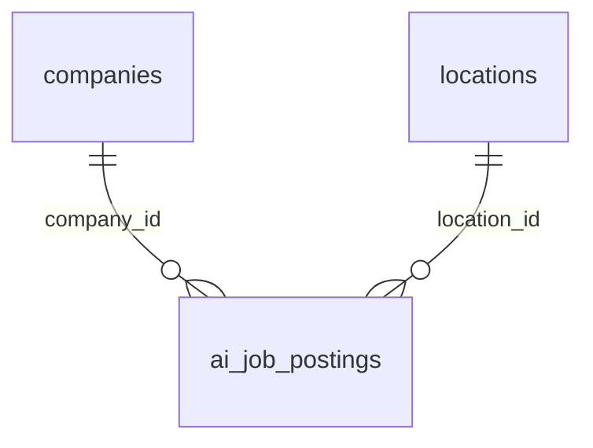

# 500K AI Jobs & Salaries Dataset (2024-2026)

**509K AI and data job postings, 42 columns: pay, skills, hiring in 21 countries.**

509,441 job postings for AI, machine-learning and data roles, posted between January 2024 and September 2026 by 510 companies in 49 cities and 21 countries. Each posting has the role and level, the company, the location, what the job asks for (degree, skills, framework, LLM experience, Python, cloud), the pay (yearly salary in USD and in local currency, bonus, equity, paid leave) and how hiring went (applicants, views, status, days to fill). The main file is one wide table that works on its own; two small lookup tables describe the companies and the cities. All companies are fictional.

| | |
|---|---|
| Tables | 3 |
| Rows | 510,000 |
| Full data | Kaggle (coming soon): CSV files and a SQLite database |
| Sample in this folder | [`sample/`](sample/), a connected slice of up to 1,000 rows per table |
| Licence | [CC BY 4.0](../LICENSE): free to use, share and adapt, with credit |
| Made with | [GenerateRealData](https://www.generaterealdata.com/use-cases/machine-learning-training-data/), fully synthetic, no real records |

## What makes it useful

- One wide table: 42 columns for every posting, ready for pandas or a model, with the company and city details already joined in.
- A salary you can learn: pay depends on the role, the seniority, the company's size and industry, local pay levels, the degree, LLM experience and remote work, plus about +-30% left to chance and a few unusually well-paid postings. A gradient-boosting model on the posting's own columns reaches R-squared 0.86 on held-out postings: learnable, not trivial.
- 33 job titles in 11 role families, from Generative AI and LLM engineering to MLOps, AI research, analytics and AI governance; six seniority levels from intern to principal.
- Pay in USD and in 17 local currencies, for cities from San Francisco and Zurich to Bengaluru, Sao Paulo and Warsaw.
- The details agree everywhere: experience, bonus and interview rounds follow the level; deadlines, fill times and statuses follow the posting date; every posting matches its company and city. 26 rules are checked with SQL.
- Growth over time: more postings each year, 92K in 2024, 183K in 2025 and 234K in the first nine months of 2026.

**Good for:** Salary prediction (regression) and feature engineering; Exploratory analysis and dashboards of AI hiring; Classification: will a posting be filled, how fast; SQL practice with one wide table and two lookups; Teaching data leakage (salary_local gives the answer away).

## Tables



| Table | Rows | What it holds |
|---|---:|---|
| `locations` | 49 | The 49 cities postings are in. |
| `companies` | 510 | The 510 hiring companies. |
| `ai_job_postings` | 509,441 | One row per job posting: the main table. |

## Rules you can rely on

26 rules were checked on the full dataset and all 26 hold. Each rule is a query that counts the rows breaking it, and every count is 0. The queries are in [`checks.sql`](checks.sql).

- ai_job_postings.job_id is unique
- companies.company_id is unique
- companies.company_name is unique
- locations.location_id is unique
- Every ai_job_postings.company_id exists in companies
- Every ai_job_postings.location_id exists in locations
- Every posting carries its company's name, industry, size, funding stage, AI maturity and rating
- Every posting carries its location's city, country, region, cost-of-living index and currency
- salary_local = salary_usd x the location's exchange rate, rounded to hundreds
- salary_usd is positive and a whole multiple of 100
- Each job title belongs to exactly one role family
- Postings run from 2024-01-01 to 2026-09-30
- The application deadline is 14-60 days after posting
- days_to_fill is set exactly for filled postings
- A filled posting is filled by 2026-09-30
- Postings from the last two weeks are still open or closed, never filled or expired
- Only postings from July 2026 on are still open
- Interns are internships with no experience required and no bonus
- Years of experience match the seniority level
- The bonus range matches the seniority level
- Interview rounds: 2-3 for interns and juniors, 3-5 for mid and senior, 4-6 above
- Views are 6-22 times the applicants
- Paid leave in Europe is 25-32 days
- Startups are seed to Series B or bootstrapped; large and enterprise companies are public or private
- Startups were founded from 2018 on
- Company ratings are between 2.0 and 5.0

## Column dictionary

The last column is measured from the data.

### `locations` (49 rows)

The 49 cities postings are in.

| Column | Type | Meaning | In this dataset |
|---|---|---|---|
| `location_id` (PK) | INTEGER | Location number (primary key). | 1 to 49 |
| `city` | VARCHAR(60) | City name. | 49 different values, e.g. `Los Angeles` |
| `country` | VARCHAR(60) | Country of the city. | 21 different values, e.g. `United States` |
| `region` | VARCHAR(40) | World region: North America, Europe, South Asia, East Asia and Pacific, Middle East or Latin America. | `North America` 34.7%, `Europe` 28.6%, `East Asia and Pacific` 16.3%, `South Asia` 12.2%, `Middle East` 4.1%, `Latin America` 4.1% |
| `currency` | CHAR(3) | Local currency code (ISO 4217). | 17 different values, e.g. `USD` |
| `usd_to_local` | NUMERIC(12,4) | Local currency units per US dollar (approximate 2026 rate, fixed for the whole period). | 0.79 to 1,350 |
| `cost_of_living_index` | INTEGER | Approximate cost-of-living and pay level of the city, US average = 100. | 18 to 128 |

### `companies` (510 rows)

The 510 hiring companies.

| Column | Type | Meaning | In this dataset |
|---|---|---|---|
| `company_id` (PK) | INTEGER | Company number (primary key). | 1 to 510 |
| `company_name` | VARCHAR(80) | Unique, fictional company name. | 510 different values, e.g. `Arcadia Works`, `Helix Intelligence` |
| `industry` | VARCHAR(40) | One of 12 industries. | `Technology` 31%, `Finance and Banking` 12.2%, `Healthcare and Pharma` 11%, `Retail and E-commerce` 7.6%, `Consulting` 7.5%, `Manufacturing` 6.7%, `Government and Public Sector` 4.9%, `Education` 4.9% and 4 more |
| `company_size` | VARCHAR(30) | Startup (1-50 people), Small (51-200), Mid-size (201-1,000), Large (1,001-10,000) or Enterprise (10,000+). | `Startup` 28%, `Mid-size` 22.2%, `Small` 20.2%, `Large` 19.4%, `Enterprise` 10.2% |
| `funding_stage` | VARCHAR(20) | Seed, Series A, Series B, Series C+, Bootstrapped, Private or Public; follows the size. | `Public` 24.9%, `Private` 18%, `Series A` 13.9%, `Series C+` 12.9%, `Series B` 12.4%, `Seed` 11.2%, `Bootstrapped` 6.7% |
| `founded_year` | INTEGER | Year founded; startups from 2018 on, large companies as early as 1950. | 1950 to 2025 |
| `ai_maturity` | VARCHAR(20) | How far the company is with AI: Exploring, Piloting, Scaling or AI-native. | `Scaling` 32.2%, `Piloting` 30.2%, `AI-native` 19.6%, `Exploring` 18% |
| `company_rating` | NUMERIC(2,1) | Employee rating of the company, 2.0 to 5.0. | 2.3 to 5 |

### `ai_job_postings` (509,441 rows)

One row per job posting: the main table.

| Column | Type | Meaning | In this dataset |
|---|---|---|---|
| `job_id` (PK) | VARCHAR(12) | Posting id, AIJ-000001 onwards (primary key). | AIJ-000001 to AIJ-509441 |
| `posted_date` | DATE | Date the job was posted, 2024-01-01 to 2026-09-30. | 2024-01-01 to 2026-09-29 |
| `application_deadline` | DATE | Last day to apply, 14-60 days after posting. | 2024-01-15 to 2026-11-28 |
| `posting_status` | VARCHAR(10) | Status on 2026-09-30: Open, Filled, Closed or Expired. Recent postings are mostly open; older ones are filled, closed or expired. | `Filled` 58.2%, `Closed` 19.1%, `Expired` 16.6%, `Open` 6.1% |
| `job_title` | VARCHAR(60) | One of 33 AI and data job titles. | 33 different values, e.g. `LLM Engineer`, `Machine Learning Engineer` |
| `role_family` | VARCHAR(40) | One of 11 role families; each title belongs to exactly one. | `Generative AI` 17.6%, `Machine Learning` 13.9%, `Data Engineering` 12.9%, `Data Science` 12.1%, `Analytics` 12%, `AI Product and Strategy` 10.2%, `MLOps and Infrastructure` 6.5%, `AI Research` 4.6% and 3 more |
| `seniority_level` | VARCHAR(10) | Intern, Junior, Mid, Senior, Lead or Principal. | `Mid` 34.2%, `Senior` 27.1%, `Junior` 20.6%, `Lead` 9.1%, `Intern` 4.6%, `Principal` 4.4% |
| `years_experience_required` | INTEGER | Years of experience asked for; the range follows the level (0 for interns, 10-18 for principal). | 0 to 18 |
| `employment_type` | VARCHAR(12) | Full-time, Contract, Freelance, Part-time, or Internship (always and only for interns). | `Full-time` 80.2%, `Contract` 10.5%, `Internship` 4.6%, `Freelance` 2.9%, `Part-time` 1.9% |
| `company_id` → `companies.company_id` | INTEGER | The hiring company. | 1 to 510 |
| `company_name` | VARCHAR(80) | The company's name (copied from companies). | 510 different values, e.g. `Wavelength Software`, `Cascade Solutions` |
| `industry` | VARCHAR(40) | The company's industry (copied from companies). | `Technology` 30.3%, `Finance and Banking` 19.4%, `Retail and E-commerce` 10%, `Healthcare and Pharma` 9.2%, `Media and Entertainment` 6.9%, `Consulting` 4.6%, `Government and Public Sector` 4.1%, `Manufacturing` 3.9% and 4 more |
| `company_size` | VARCHAR(30) | The company's size (copied from companies). | `Large` 27.3%, `Startup` 26.9%, `Small` 16.3%, `Mid-size` 15.4%, `Enterprise` 14.1% |
| `funding_stage` | VARCHAR(20) | The company's funding stage (copied from companies). | `Private` 28.4%, `Public` 23.5%, `Series A` 14.3%, `Seed` 11.5%, `Series B` 9.9%, `Series C+` 7.1%, `Bootstrapped` 5.3% |
| `ai_maturity` | VARCHAR(20) | The company's AI maturity (copied from companies). | `Scaling` 28.9%, `Piloting` 26.7%, `AI-native` 25.6%, `Exploring` 18.8% |
| `company_rating` | NUMERIC(2,1) | The company's rating (copied from companies). | 2.3 to 5 |
| `location_id` → `locations.location_id` | INTEGER | Where the job is. | 1 to 49 |
| `city` | VARCHAR(60) | The job's city (copied from locations). | 49 different values, e.g. `Dallas`, `San Francisco` |
| `country` | VARCHAR(60) | The job's country (copied from locations). | 21 different values, e.g. `United States`, `United States` |
| `region` | VARCHAR(40) | The job's world region (copied from locations). | `North America` 34.7%, `Europe` 28.5%, `East Asia and Pacific` 16.3%, `South Asia` 12.3%, `Latin America` 4.1%, `Middle East` 4% |
| `cost_of_living_index` | INTEGER | The city's cost-of-living index (copied from locations). | 18 to 128 |
| `work_mode` | VARCHAR(10) | On-site, Hybrid or Remote; on-site is more common in Asia and the Middle East. | `Hybrid` 42.6%, `On-site` 35.9%, `Remote` 21.4% |
| `education_required` | VARCHAR(20) | No degree required, Bachelor's, Master's or PhD; AI research asks for a PhD most often. | `Bachelor's` 40.8%, `Master's` 39%, `PhD` 10.8%, `No degree required` 9.4% |
| `primary_framework` | VARCHAR(30) | The main framework or tool named in the posting, typical of the role family; 'none' for non-technical roles. | 21 different values, e.g. `LlamaIndex`, `PyTorch` |
| `required_skills` | VARCHAR(120) | The skills asked for, as a comma-separated list (one of a few sets per role family). | 45 different values, e.g. `Python, LLM fine-tuning, PyTorch, Hugging Fa`, `Python, PyTorch, Spark, MLflow, Airflow` |
| `llm_experience_required` | BOOLEAN | 1 if experience with large language models is required; most Generative AI postings, some others. | `0` 63.9%, `1` 36.1% |
| `python_required` | BOOLEAN | 1 if Python is required. | `1` 78%, `0` 22% |
| `cloud_platform` | VARCHAR(15) | AWS, Azure, Google Cloud, Any or Not specified. | `AWS` 38%, `Azure` 24%, `Google Cloud` 20%, `Any` 12%, `Not specified` 6% |
| `visa_sponsorship` | BOOLEAN | 1 if the employer sponsors a work visa; more common in the US, UK, Canada, Germany, the Netherlands and Ireland. | `0` 82.5%, `1` 17.5% |
| `salary_usd` | INTEGER | Yearly base salary in US dollars, rounded to hundreds. The column to predict. | 2,400 to 1,143,300 |
| `salary_local` | BIGINT | The same salary in the local currency (salary_usd x usd_to_local). Gives salary_usd away. | 16,744 different values, e.g. `204700`, `285300` |
| `salary_currency` | CHAR(3) | Currency of salary_local. | 17 different values, e.g. `USD`, `USD` |
| `bonus_pct` | INTEGER | Target bonus as a percentage of salary; the range follows the level (0 for interns, up to 30 for principal). | 0 to 30 |
| `equity_offered` | BOOLEAN | 1 if equity or stock is part of the offer; most likely at startups. | `0` 50.6%, `1` 49.4% |
| `paid_leave_days` | INTEGER | Paid leave days a year; highest in Europe (25-32). | 10 to 32 |
| `interview_rounds` | INTEGER | Number of interview rounds, 2-6; more for senior roles. | `4` 34.1%, `3` 27.9%, `5` 22%, `2` 12.6%, `6` 3.4% |
| `team_size` | INTEGER | Size of the team the hire joins. | 3 to 60 |
| `hiring_urgency` | VARCHAR(8) | Low, Normal or High. | `Normal` 58%, `Low` 22%, `High` 20% |
| `posting_source` | VARCHAR(20) | Where the posting was published: Job board, Company website, Recruiter or Employee referral. | `Job board` 38%, `Company website` 34%, `Recruiter` 16%, `Employee referral` 12% |
| `applicants_count` | INTEGER | Number of applicants; higher for remote and entry-level jobs and a little higher for better pay. | 12 to 1,596 |
| `views_count` | INTEGER | Number of views, 6-22 times the applicants. | 72 to 28,226 |
| `days_to_fill` | INTEGER | Days from posting to hire, for filled postings only; empty otherwise. Never past 2026-09-30. | 14 to 95; 41.8% empty |

## Questions to try

**Average salary by seniority level**

```sql
SELECT seniority_level, COUNT(*) AS postings, ROUND(AVG(salary_usd)) AS avg_salary_usd,
       MIN(salary_usd) AS min_usd, MAX(salary_usd) AS max_usd
FROM ai_job_postings GROUP BY seniority_level ORDER BY avg_salary_usd;
```

**The ten best-paid job titles**

```sql
SELECT job_title, role_family, COUNT(*) AS postings, ROUND(AVG(salary_usd)) AS avg_salary_usd
FROM ai_job_postings GROUP BY job_title, role_family ORDER BY avg_salary_usd DESC LIMIT 10;
```

**Pay by country, in dollars and in the local currency**

```sql
SELECT country, salary_currency, COUNT(*) AS postings, ROUND(AVG(salary_usd)) AS avg_usd, ROUND(AVG(salary_local)) AS avg_local
FROM ai_job_postings GROUP BY country, salary_currency ORDER BY avg_usd DESC;
```

Seven more are in [`questions.sql`](questions.sql). All ten run as written on the SQLite file.

## Good to know

- The salary is built from the factors listed above, so a model learns exactly those; use the dataset to practise modelling, not as evidence about real AI pay.
- salary_local is salary_usd times a fixed exchange rate per currency (approximate 2026 rates, the same for the whole period), so it gives the answer away: drop it when predicting salary_usd.
- Salaries do not change over time: a 2024 posting and a 2026 posting with the same details pay the same on average.
- Every city gets about the same number of postings, so a country's share follows how many of its cities are listed: the United States has 14 of the 49 cities and about 29% of the postings.
- The cost-of-living index (US average = 100) is an approximate value per city, chosen for this dataset.
- Company names are invented word pairs; any match with a real company is a coincidence. Each role family asks for one of a few fixed skill sets.
- Applicants and views are driven by work mode, seniority and pay only; posting_source, hiring_urgency and team_size carry no signal.
- Yes/no columns hold 1 and 0. Empty cells in the CSV files mean no value (NULL in the database files).
- The CSV files are UTF-8. Dates are `YYYY-MM-DD` and timestamps `YYYY-MM-DD HH:MM:SS`.

## Files

| File | What it is |
|---|---|
| `schema.sql` | The `CREATE TABLE` statements (PostgreSQL syntax) the data was generated from |
| `generation.json` | Settings of the run: seed, rows per table, options |
| `plan.json` | The full generation plan: one rule set per column |
| `checks.sql` | One query per rule above; each returns 0 on the full dataset |
| `questions.sql` | Ten practice questions with their queries |
| `sample/` | `locations.csv` 49 rows; `companies.csv` 305 rows; `ai_job_postings.csv` 1,000 rows |

## Re-create it

The dataset is reproducible. With a GenerateRealData API key, [`scripts/recreate.py`](../scripts/recreate.py) sends `plan.json`, `schema.sql` and the seed `20261227` to the API and downloads the same data:

```bash
python scripts/recreate.py ai-job-market-salaries
```

To build your own version, change the row counts or rules, or start from your own schema: [generaterealdata.com/use-cases/machine-learning-training-data/](https://www.generaterealdata.com/use-cases/machine-learning-training-data/).

## How it was made

Fully synthetic: generated with [GenerateRealData](https://www.generaterealdata.com/use-cases/machine-learning-training-data/) from a database schema and a set of rules, using a fixed seed. No real person, company or transaction is in the data, and no value was edited after generation. No field was written by AI. 

## Licence

[CC BY 4.0](https://creativecommons.org/licenses/by/4.0/). Use it for anything, including commercial work; please credit "500K AI Jobs & Salaries Dataset (2024-2026), GenerateRealData" with a link to https://www.generaterealdata.com.
