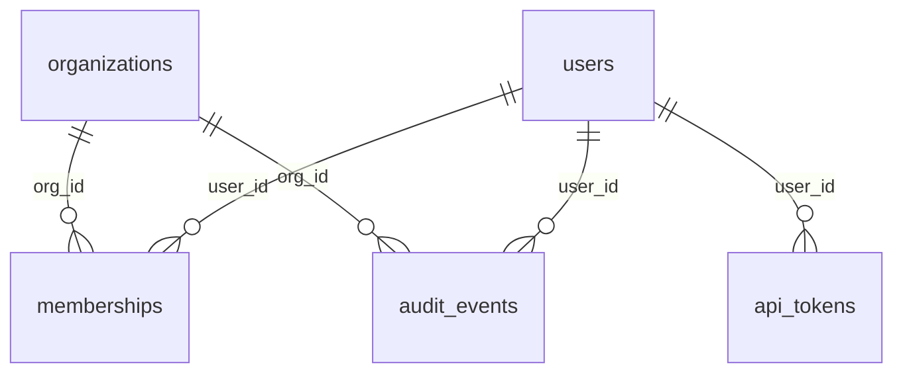

# App Users with Edge Cases for QA Testing

**Seed data that breaks naive code: Unicode, injection strings, soft deletes.**

Seed data for testing a multi-tenant web application: organizations, users, memberships, API tokens and an audit log. Most rows are ordinary. A deliberate share are the cases real applications trip over: names in Arabic, Hebrew, Chinese, Japanese, Korean, Cyrillic and Greek, emoji, one-character and 100-character names, leading and trailing spaces, SQL and HTML injection strings, plus-addressed emails, soft-deleted and never-logged-in users, expired and revoked tokens, IPv6 addresses.

| | |
|---|---|
| Tables | 5 |
| Rows | 200,000 |
| Full data | [Kaggle](https://www.kaggle.com/datasets/generaterealdata/app-users-edge-cases-qa-testing): CSV files and a SQLite database |
| Sample in this folder | [`sample/`](sample/), a connected slice of up to 1,000 rows per table |
| Licence | [CC BY 4.0](../LICENSE): free to use, share and adapt, with credit |
| Made with | [GenerateRealData](https://generaterealdata.com/industries/software-testing-qa/), fully synthetic, no real records |

## What makes it useful

- About one user in seven has a display name chosen to break something: non-Latin scripts, right-to-left text, emoji, quotes, commas, tabs, 'Null', 'undefined', '0', "Robert'); DROP TABLE users;--" and "<script>alert(1)</script>".
- Emails are always unique and always at example domains, and include plus-addressing, a subdomain and very long local parts.
- States are consistent, so your assertions can be strict: deleted users have a deletion time after creation and nobody else has one; invited users have never logged in; a membership never predates its user or organization.
- Thirty locales, each with a matching IANA time zone; a mix of IPv4 and IPv6 addresses in the audit log.

**Good for:** Seeding test and staging databases; QA of forms, search, sorting, exports and emails with awkward text; Security-testing input handling (the strings are harmless samples); Testing soft-delete, invitation and token-expiry logic.

## Tables



| Table | Rows | What it holds |
|---|---:|---|
| `organizations` | 2,000 | Tenants of the application. |
| `users` | 40,000 | User accounts, with deliberately awkward values among ordinary ones. |
| `memberships` | 46,000 | Which user belongs to which organization. Every organization and every user has at least one. |
| `api_tokens` | 6,000 | API tokens issued to users. |
| `audit_events` | 106,000 | The audit log. |

## Rules you can rely on

30 rules were checked on the full dataset and all 30 hold. Each rule is a query that counts the rows breaking it, and every count is 0. The queries are in [`checks.sql`](checks.sql).

- organizations.org_id is unique
- organizations.slug is unique
- users.user_id is unique
- users.email is unique
- Every memberships.org_id exists in organizations
- Every memberships.user_id exists in users
- Every api_tokens.user_id exists in users
- Every audit_events.org_id exists in organizations
- Every audit_events.user_id exists in users
- Emails use example domains only
- Plus-addressed emails are present
- Non-Latin, right-to-left and injection-style names are present
- Edge-case names are 10-20% of users
- deleted_at is set exactly for deleted users
- deleted_at is after created_at
- Invited users have never logged in
- Last login is after creation
- Every organization has a membership
- joined_at is not before the organization existed
- A token expires 30-365 days after creation
- revoked_at is after created_at
- Both IPv4 and IPv6 addresses are present
- No token is created or revoked after 2026-09-30
- A token is revoked before it expires
- A token is never created before its user
- No audit event is dated after 2026-09-30
- An audit event never happens before its user or organization existed
- No login or deletion is dated after 2026-09-30
- No membership starts after 2026-09-30
- A membership never starts before the user's account existed

## Column dictionary

The last column is measured from the data.

### `organizations` (2,000 rows)

Tenants of the application.

| Column | Type | Meaning | In this dataset |
|---|---|---|---|
| `org_id` (PK) | INTEGER | Organization number (primary key). | 1 to 2,000 |
| `org_name` | VARCHAR(160) | Company name (invented). | 1,882 different values, e.g. `Wilson-Salazar`, `Harrison-Johnson` |
| `slug` | VARCHAR(80) | Unique URL slug: team-1, team-2 ... | 2,000 different values, e.g. `team-102`, `team-1072` |
| `plan` | VARCHAR(12) | Subscription plan. | `free` 53.8%, `team` 28.6%, `business` 12.7%, `enterprise` 4.8% |
| `created_at` | TIMESTAMP | When the organization was created. | 2021-01-03 01:18:04 to 2026-08-14 15:32:32 |

### `users` (40,000 rows)

User accounts, with deliberately awkward values among ordinary ones.

| Column | Type | Meaning | In this dataset |
|---|---|---|---|
| `user_id` (PK) | INTEGER | User number (primary key). | 1 to 40,000 |
| `email` | VARCHAR(254) | Unique email at an example domain; includes plus-addressing (user3+billing@example.com), a subdomain and very long local parts. | 40,000 different values, e.g. `first.middle.last.with.a.very.long.local.par`, `first.middle.last.with.a.very.long.local.par` |
| `display_name` | VARCHAR(160) | Name shown in the app. Mostly ordinary names; about 15% are edge cases (see above). | 28,900 different values, e.g. `Jessica Wood`, `Name "Quoted" Person` |
| `locale` | VARCHAR(8) | Language and region, e.g. en-US, pt-BR, ar-AE, ja-JP (30 values). | 30 different values, e.g. `en-US`, `en-US` |
| `time_zone` | VARCHAR(40) | IANA time zone that fits the locale. | 29 different values, e.g. `America/New_York`, `America/New_York` |
| `mfa_enabled` | BOOLEAN | Whether two-factor login is on (1 = yes). | `0` 62.2%, `1` 37.8% |
| `status` | VARCHAR(10) | active, invited, suspended or deleted. | `active` 80.2%, `invited` 8.9%, `deleted` 6%, `suspended` 5% |
| `created_at` | TIMESTAMP | When the account was created. | 2021-01-01 00:40:14 to 2026-08-30 22:29:46 |
| `last_login_at` | TIMESTAMP | Most recent login, after created_at; empty for invited users and a few others. | 2021-01-22 12:50:31 to 2026-09-29 21:56:51; 13.6% empty |
| `deleted_at` | TIMESTAMP | Soft-delete time, after created_at; set exactly when status is deleted. | 2021-02-06 00:32:45 to 2026-09-29 11:06:16; 94% empty |

### `memberships` (46,000 rows)

Which user belongs to which organization. Every organization and every user has at least one.

| Column | Type | Meaning | In this dataset |
|---|---|---|---|
| `membership_id` (PK) | INTEGER | Membership number (primary key). | 1 to 46,000 |
| `org_id` → `organizations.org_id` | INTEGER | The organization. | 1 to 2,000 |
| `user_id` → `users.user_id` | INTEGER | The user. | 1 to 40,000 |
| `role` | VARCHAR(8) | owner, admin, member or viewer. | `member` 70%, `admin` 13.8%, `viewer` 11.2%, `owner` 5% |
| `joined_at` | TIMESTAMP | When the user joined; never before the user or the organization existed. | 2021-04-09 07:18:51 to 2026-09-28 22:58:16 |

### `api_tokens` (6,000 rows)

API tokens issued to users.

| Column | Type | Meaning | In this dataset |
|---|---|---|---|
| `token_id` (PK) | INTEGER | Token number (primary key). | 1 to 6,000 |
| `user_id` → `users.user_id` | INTEGER | The token's owner. | 4 to 39,999 |
| `token_prefix` | VARCHAR(12) | Visible prefix of the token: tok_ plus six letters or digits (not a working secret). | 6,000 different values, e.g. `tok_a84xec`, `tok_tyu4qw` |
| `scopes` | VARCHAR(60) | Permissions granted. | `read` 47.8%, `read write` 35%, `read write admin` 9.4%, `billing` 7.7% |
| `created_at` | TIMESTAMP | When the token was created. | 2023-01-02 14:41:25 to 2026-09-27 05:46:16 |
| `expires_at` | TIMESTAMP | Expiry, 31-365 days after creation; many have already expired. | 2023-02-09 00:00:00 to 2027-09-06 00:00:00 |
| `revoked_at` | TIMESTAMP | When the token was revoked; empty for most tokens. | 2023-02-19 00:00:00 to 2026-09-29 00:00:00; 84.8% empty |

### `audit_events` (106,000 rows)

The audit log.

| Column | Type | Meaning | In this dataset |
|---|---|---|---|
| `event_id` (PK) | INTEGER | Event number (primary key). | 1 to 106,000 |
| `org_id` → `organizations.org_id` | INTEGER | The organization the event belongs to. | 1 to 2,000 |
| `user_id` → `users.user_id` | INTEGER | The user who acted. | 1 to 40,000 |
| `action` | VARCHAR(30) | What happened, e.g. user.login, role.change, token.revoke. | `user.login` 33.9%, `user.logout` 21.9%, `export.download` 12.1%, `member.invite` 7%, `token.create` 6.1%, `org.update` 5%, `user.password_reset` 4.1%, `role.change` 3.9% and 2 more |
| `target_type` | VARCHAR(20) | The kind of object acted on; always the same for an action. | `user` 59.9%, `membership` 14%, `export` 12.1%, `token` 9%, `organization` 5% |
| `ip_address` | VARCHAR(45) | Client address: IPv4 for about 80% of events, IPv6 for the rest. | 106,000 different values, e.g. `15ea:b263:8c10:c5e4:68d6:7515:daa6:b5e0`, `2.157.131.151` |
| `occurred_at` | TIMESTAMP | When it happened. | 2023-01-01 00:48:48 to 2026-09-29 23:39:14 |

## Questions to try

**The edge-case names and how often each appears**

```sql
SELECT display_name, LENGTH(display_name) AS characters, COUNT(*) AS users
FROM users GROUP BY display_name HAVING COUNT(*) > 100 ORDER BY users DESC LIMIT 40;
```

**Names that contain characters outside basic ASCII**

```sql
SELECT COUNT(*) AS users_with_non_ascii_names
FROM users WHERE display_name GLOB '*[^ -~]*';
```

**Names with leading or trailing whitespace, or a tab inside**

```sql
SELECT '[' || display_name || ']' AS shown_in_brackets, COUNT(*) AS users
FROM users WHERE display_name <> TRIM(display_name) OR display_name LIKE '%' || char(9) || '%'
GROUP BY display_name;
```

Seven more are in [`questions.sql`](questions.sql). All ten run as written on the SQLite file.

## Good to know

- The injection-style names are inert test strings; they are there so you can confirm your application stores and shows them safely.
- Organization slugs are simply team-1, team-2 and so on; they are not derived from the organization name.
- Roles are assigned independently, so an organization can have several owners or none.
- Audit events are not tied to memberships: the user of an event is not necessarily a member of its organization.
- Yes/no columns hold 1 and 0. Empty cells in the CSV files mean no value (NULL in the database files).
- The CSV files are UTF-8. Dates are `YYYY-MM-DD` and timestamps `YYYY-MM-DD HH:MM:SS`.

## Files

| File | What it is |
|---|---|
| `schema.sql` | The `CREATE TABLE` statements (PostgreSQL syntax) the data was generated from |
| `generation.json` | Settings of the run: seed, rows per table, options |
| `plan.json` | The full generation plan: one rule set per column |
| `checks.sql` | One query per rule above; each returns 0 on the full dataset |
| `questions.sql` | Ten practice questions with their queries |
| `sample/` | `organizations.csv` 563 rows; `users.csv` 353 rows; `memberships.csv` 414 rows; `api_tokens.csv` 50 rows; `audit_events.csv` 1,000 rows |

## Re-create it

The dataset is reproducible. With a GenerateRealData API key, [`scripts/recreate.py`](../scripts/recreate.py) sends `plan.json`, `schema.sql` and the seed `20261111` to the API and downloads the same data:

```bash
python scripts/recreate.py app-users-edge-cases
```

To build your own version, change the row counts or rules, or start from your own schema: [generaterealdata.com/industries/software-testing-qa/](https://generaterealdata.com/industries/software-testing-qa/).

## How it was made

Fully synthetic: generated with [GenerateRealData](https://generaterealdata.com/industries/software-testing-qa/) from a database schema and a set of rules, using a fixed seed. No real person, company or transaction is in the data, and no value was edited after generation. No field was written by AI. 

## Licence

[CC BY 4.0](https://creativecommons.org/licenses/by/4.0/). Use it for anything, including commercial work; please credit "App Users with Edge Cases for QA Testing, GenerateRealData" with a link to https://generaterealdata.com.
