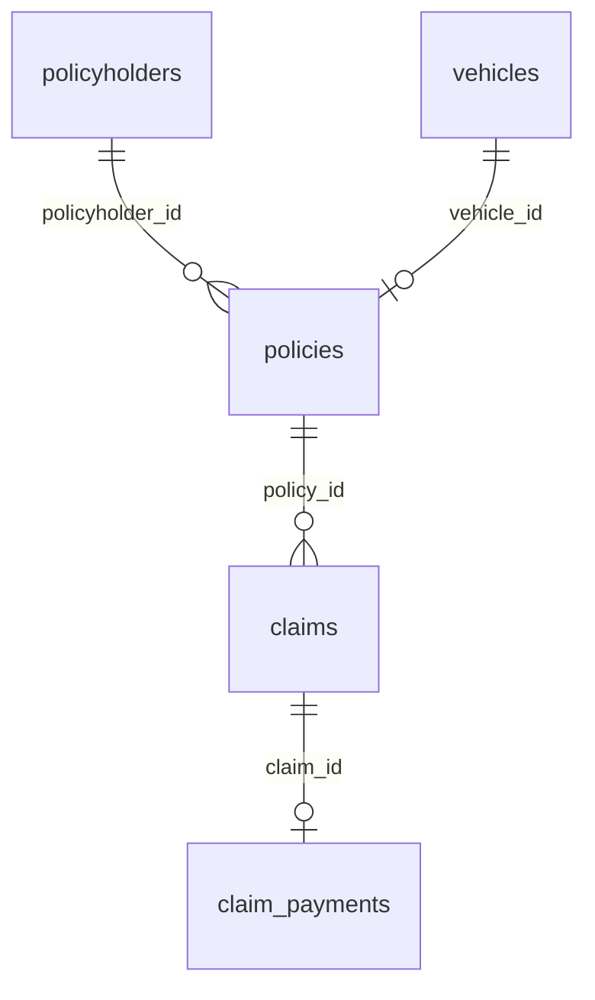

# Synthetic Auto Insurance Policies and Claims

**190K rows: policyholders, vehicles, policies, claims and claim payments.**

A US auto insurer writing one-year policies from January 2023, seen as of 30 September 2026. Thirty thousand policyholders in thirteen states insure 37,000 vehicles, and 50,000 claims move from filed to paid or denied. Perils follow geography: hail in the plains states, flood on the Gulf coast. All people and vehicles are fictional.

| | |
|---|---|
| Tables | 5 |
| Rows | 192,843 |
| Full data | [Kaggle](https://www.kaggle.com/datasets/generaterealdata/synthetic-auto-insurance-claims): CSV files and a SQLite database |
| Sample in this folder | [`sample/`](sample/), a connected slice of up to 1,000 rows per table |
| Licence | [CC BY 4.0](../LICENSE): free to use, share and adapt, with credit |
| Made with | [GenerateRealData](https://www.generaterealdata.com/industries/insurance/?ref=github), fully synthetic, no real records |

## What makes it useful

- Claims sit inside their policy: the loss date is within the policy year, and the loss state is the policyholder's state.
- Reserves and payments obey the claim status: open claims hold a reserve equal to the claim amount and no payment; denied claims hold neither; paid claims have no reserve left and paid_total equals their payments.
- Time shapes the book: losses since August 2026 are not yet paid, older ones are settled; ended policies are expired or cancelled and running ones are active.
- Geography is coherent: every city belongs to its state, ZIP codes start with that city's real prefix, and hail and flood claims cluster in the states where they happen.

**Good for:** Claims analytics: frequency, severity, loss ratio, reserves; Testing policy-administration and claims systems; SQL practice across a five-table insurance schema; Teaching insurance data modelling.

## Tables



| Table | Rows | What it holds |
|---|---:|---|
| `policyholders` | 30,000 | Customers of the insurer. |
| `vehicles` | 37,000 | Insured vehicles. |
| `policies` | 37,000 | One policy per vehicle. |
| `claims` | 50,000 | Claims made on policies. |
| `claim_payments` | 38,843 | Payments on paid claims. |

## Rules you can rely on

35 rules were checked on the full dataset and all 35 hold. Each rule is a query that counts the rows breaking it, and every count is 0. The queries are in [`checks.sql`](checks.sql).

- policyholders.policyholder_id is unique
- vehicles.vin is unique
- policies.policy_number is unique
- policies.vehicle_id is unique
- claims.claim_number is unique
- Every policies.policyholder_id exists in policyholders
- Every policies.vehicle_id exists in vehicles
- Every claims.policy_id exists in policies
- Every claim_payments.claim_id exists in claims
- VINs are 17 characters without I, O or Q
- A model always belongs to the same make
- A city never appears under two states
- Licensed at 16 or older
- A policy lasts one year
- Policies still running are active
- Loss date is inside the policy period
- Reported 0-10 days after the loss
- Loss state is the policyholder's state
- Hail is more common in TX, CO, OK and KS than elsewhere
- Flood is more common in FL and LA than elsewhere
- Open claims hold a reserve and no payment
- Denied claims have no reserve and no payment
- Paid claims have no reserve left
- claim_payments.claim_id is unique
- Ended policies are expired or cancelled
- No loss is dated after 30 September 2026
- A payment never exceeds the claim amount
- Payments exist only for paid claims
- Every paid claim has at least one payment
- paid_total = sum of the claim's payments
- Payment is made after the claim was reported
- Claims for losses from August 2026 on are not yet paid
- Claims for losses before May 2026 are settled or under investigation
- No payment is dated after 2026-09-30
- No claim is reported after 2026-09-30

## Column dictionary

The last column is measured from the data.

### `policyholders` (30,000 rows)

Customers of the insurer.

| Column | Type | Meaning | In this dataset |
|---|---|---|---|
| `policyholder_id` (PK) | INTEGER | Policyholder number (primary key). | 1 to 30,000 |
| `full_name` | VARCHAR(120) | Full name (fictional). | 25,719 different values, e.g. `Heather Watkins`, `Kimberly Huang` |
| `date_of_birth` | DATE | Date of birth. | 1941-01-01 to 2004-12-30 |
| `state` | CHAR(2) | US state, as a two-letter code (thirteen states). | `TX` 16.3%, `CA` 15.9%, `FL` 13%, `NY` 8%, `IL` 5.9%, `WA` 5.9%, `CO` 5.8%, `GA` 5.8% and 5 more |
| `city` | VARCHAR(80) | A real city of that state. | 38 different values, e.g. `Oklahoma City`, `New Orleans` |
| `zip_code` | VARCHAR(10) | Five-digit ZIP code starting with that city's real three-digit prefix. | 3,791 different values, e.g. `73125`, `70114` |
| `licensed_since` | DATE | Date the driving licence was issued; at age 16 or older. | 1957-02-18 to 2025-11-07 |
| `credit_band` | VARCHAR(10) | Credit rating band. | `good` 42.5%, `fair` 26.2%, `excellent` 21.4%, `poor` 9.9% |

### `vehicles` (37,000 rows)

Insured vehicles.

| Column | Type | Meaning | In this dataset |
|---|---|---|---|
| `vehicle_id` (PK) | INTEGER | Vehicle number (primary key). | 1 to 37,000 |
| `vin` | CHAR(17) | Unique 17-character vehicle identification number (never uses I, O or Q). | 37,000 different values, e.g. `02RF6FCG53WDJXEYU`, `055YUPP214UWL4TDH` |
| `make` | VARCHAR(30) | Manufacturer; always matches the model. | `Ford` 13.3%, `Toyota` 13.2%, `Honda` 10%, `Jeep` 6.8%, `Chevrolet` 6.8%, `Nissan` 6.8%, `Subaru` 6.7%, `Tesla` 6.7% and 8 more |
| `model` | VARCHAR(40) | Model (30 common US models). | 30 different values, e.g. `Mustang`, `Escape` |
| `model_year` | INTEGER | Model year, 2008-2026. | 2008 to 2026 |
| `body_type` | VARCHAR(12) | Body style; always the same for a model. | `suv` 46.8%, `sedan` 26.6%, `pickup` 13.4%, `hatchback` 6.7%, `coupe` 3.3%, `van` 3.2% |
| `market_value` | NUMERIC(10,2) | Market value in USD; higher for newer model years. | 3,000.55 to 84,988.7 |

### `policies` (37,000 rows)

One policy per vehicle.

| Column | Type | Meaning | In this dataset |
|---|---|---|---|
| `policy_id` (PK) | INTEGER | Policy number in this dataset (primary key). | 1 to 37,000 |
| `policy_number` | VARCHAR(16) | Unique policy reference, POL-00-000000 format. | 37,000 different values, e.g. `POL-00-554927`, `POL-00-597766` |
| `policyholder_id` → `policyholders.policyholder_id` | INTEGER | The policyholder. Some hold two or three policies. | 1 to 30,000 |
| `vehicle_id` → `vehicles.vehicle_id` | INTEGER | The insured vehicle (each appears once). | 1 to 37,000 |
| `coverage` | VARCHAR(14) | liability, collision or comprehensive. | `comprehensive` 45.7%, `collision` 30.3%, `liability` 24% |
| `deductible` | INTEGER | Deductible in USD: 250, 500, 1000 or 2000. | `500` 45.2%, `1000` 29.6%, `250` 15.2%, `2000` 10% |
| `annual_premium` | NUMERIC(10,2) | Yearly premium in USD; higher for wider coverage. | 500.11 to 4,199.84 |
| `start_date` | DATE | First day of cover. | 2023-01-01 to 2026-06-29 |
| `end_date` | DATE | One year after start_date. | 2024-01-01 to 2027-06-29 |
| `status` | VARCHAR(10) | active while the policy is still running; expired or cancelled once it has ended. | `expired` 74.1%, `active` 21.3%, `cancelled` 4.7% |

### `claims` (50,000 rows)

Claims made on policies.

| Column | Type | Meaning | In this dataset |
|---|---|---|---|
| `claim_id` (PK) | INTEGER | Claim number in this dataset (primary key). | 1 to 50,000 |
| `claim_number` | VARCHAR(14) | Unique claim reference, CLM-0000001 onwards. | 50,000 different values, e.g. `CLM-0000005`, `CLM-0000102` |
| `policy_id` → `policies.policy_id` | INTEGER | The policy claimed on. | 1 to 36,999 |
| `loss_date` | DATE | Date of the loss; inside the policy period. | 2023-01-03 to 2026-09-30 |
| `reported_on` | DATE | Date the loss was reported, 0-10 days after loss_date. | 2023-01-04 to 2026-09-30 |
| `loss_state` | CHAR(2) | State where the loss happened; equals the policyholder's state. | `TX` 16.4%, `CA` 15.9%, `FL` 13%, `NY` 8.2%, `CO` 6%, `WA` 5.9%, `IL` 5.8%, `GA` 5.8% and 5 more |
| `peril` | VARCHAR(16) | Cause of loss. Hail is far more common in TX, CO, OK and KS; flood in FL and LA. | `collision` 50.8%, `glass` 13.5%, `hail` 9.8%, `theft` 8.7%, `vandalism` 6.2%, `animal` 5.1%, `flood` 4%, `fire` 2% |
| `status` | VARCHAR(14) | filed, under_review, investigation, paid or denied; depends on how recent the loss is. | `paid` 77.7%, `denied` 10.8%, `investigation` 4.3%, `under_review` 4.1%, `filed` 3.1% |
| `claim_amount` | NUMERIC(12,2) | Amount claimed in USD; right-skewed, with glass claims small. | 150.15 to 59,998.32 |
| `reserve_amount` | NUMERIC(12,2) | Money set aside: the claim amount while the claim is open, 0 once paid or denied. | 0 to 59,949.61 |
| `paid_total` | NUMERIC(12,2) | Sum of the claim's payments; 0 unless paid. | 0 to 59,253.26 |

### `claim_payments` (38,843 rows)

Payments on paid claims.

| Column | Type | Meaning | In this dataset |
|---|---|---|---|
| `payment_id` (PK) | INTEGER | Payment number (primary key). | 1 to 38,843 |
| `claim_id` → `claims.claim_id` | INTEGER | The paid claim (each appears once). | 1 to 50,000 |
| `paid_on` | DATE | Payment date; after the claim was reported. | 2023-01-16 to 2026-09-21 |
| `amount` | NUMERIC(12,2) | Amount paid in USD; never more than the claim amount. | 93.88 to 59,253.26 |
| `payee` | VARCHAR(16) | Who received the money. | `repair_shop` 54.3%, `policyholder` 33.4%, `third_party` 8.2%, `medical_provider` 4% |
| `method` | VARCHAR(14) | How it was paid. | `bank_transfer` 68%, `check` 24%, `card` 8% |

## Questions to try

**Claims and average claim amount by peril**

```sql
SELECT peril, COUNT(*) AS claims, ROUND(AVG(claim_amount), 2) AS avg_claim, ROUND(SUM(paid_total), 2) AS total_paid
FROM claims GROUP BY peril ORDER BY claims DESC;
```

**Where does hail and flood happen?**

```sql
SELECT loss_state, COUNT(*) AS claims, ROUND(100.0 * SUM(peril = 'hail') / COUNT(*), 1) AS hail_pct,
       ROUND(100.0 * SUM(peril = 'flood') / COUNT(*), 1) AS flood_pct
FROM claims GROUP BY loss_state ORDER BY hail_pct DESC;
```

**Loss ratio by coverage: paid claims versus premium**

```sql
SELECT p.coverage, COUNT(*) AS policies, ROUND(SUM(p.annual_premium), 0) AS premium, ROUND(SUM(x.paid), 0) AS paid,
       ROUND(100.0 * SUM(x.paid) / SUM(p.annual_premium), 1) AS loss_ratio_pct
FROM policies p LEFT JOIN (SELECT policy_id, SUM(paid_total) AS paid FROM claims GROUP BY policy_id) x USING (policy_id)
GROUP BY p.coverage;
```

Seven more are in [`questions.sql`](questions.sql). All ten run as written on the SQLite file.

## Good to know

- Premium depends only on the coverage type; it does not reflect the driver's age, credit band or the vehicle's value, so the data is not suitable for pricing models.
- Claims are far more frequent than in a real portfolio (about 1.35 per policy, and a few policies have dozens), so loss ratios come out well above 100%.
- Each paid claim has exactly one payment, of 60-100% of the claim amount.
- Perils depend on the state but not on the season.
- VINs have the right length and alphabet but are not decodable to the listed make, model or year.
- Yes/no columns hold 1 and 0. Empty cells in the CSV files mean no value (NULL in the database files).
- The CSV files are UTF-8. Dates are `YYYY-MM-DD` and timestamps `YYYY-MM-DD HH:MM:SS`.

## Files

| File | What it is |
|---|---|
| `schema.sql` | The `CREATE TABLE` statements (PostgreSQL syntax) the data was generated from |
| `generation.json` | Settings of the run: seed, rows per table, options |
| `plan.json` | The full generation plan: one rule set per column |
| `checks.sql` | One query per rule above; each returns 0 on the full dataset |
| `questions.sql` | Ten practice questions with their queries |
| `sample/` | `policyholders.csv` 572 rows; `vehicles.csv` 703 rows; `policies.csv` 703 rows; `claims.csv` 998 rows; `claim_payments.csv` 755 rows |

## Re-create it

The dataset is reproducible. With a GenerateRealData API key, [`scripts/recreate.py`](../scripts/recreate.py) sends `plan.json`, `schema.sql` and the seed `20261110` to the API and downloads the same data:

```bash
python scripts/recreate.py auto-insurance-claims
```

To build your own version, change the row counts or rules, or start from your own schema: [generaterealdata.com/industries/insurance/](https://www.generaterealdata.com/industries/insurance/?ref=github).

## How it was made

Fully synthetic: generated with [GenerateRealData](https://www.generaterealdata.com/industries/insurance/?ref=github) from a database schema and a set of rules, using a fixed seed. No real person, company or transaction is in the data, and no value was edited after generation. No field was written by AI. 

## Licence

[CC BY 4.0](https://creativecommons.org/licenses/by/4.0/). Use it for anything, including commercial work; please credit "Synthetic Auto Insurance Policies and Claims, GenerateRealData" with a link to https://www.generaterealdata.com.
