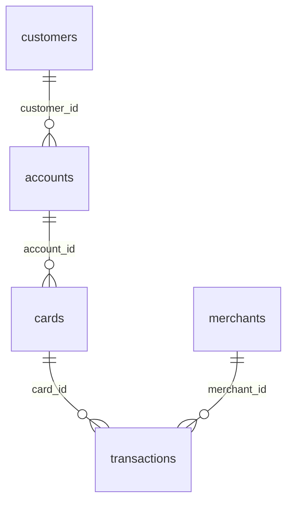

# Synthetic Bank Card Transactions with Fraud Labels

**420K labelled card transactions across customers, accounts and merchants.**

A retail bank's card payments from 1 April to 30 September 2026. Customers in seven countries hold accounts, accounts have cards, and cards pay merchants in fourteen categories. About 1.5% of the 420,000 transactions are labelled as fraud, and the fraud looks different from normal spending in ways a model or a rule can find.

| | |
|---|---|
| Tables | 5 |
| Rows | 500,000 |
| Full data | [Kaggle](https://www.kaggle.com/datasets/generaterealdata/synthetic-card-transactions-fraud-labels): CSV files and a SQLite database |
| Sample in this folder | [`sample/`](sample/), a connected slice of up to 1,000 rows per table |
| Licence | [CC BY 4.0](../LICENSE): free to use, share and adapt, with credit |
| Made with | [GenerateRealData](https://www.generaterealdata.com/use-cases/fraud-detection-data/?ref=github), fully synthetic, no real records |

## What makes it useful

- A labelled, imbalanced target (is_fraud, about 1.5%) with signals that separate it: fraud is entered outside the customer's country, far from the previous transaction, at high velocity and mostly online.
- A real relational chain to join through: transaction -> card -> account -> customer, plus merchants.
- Consistent details: a merchant category always has the same MCC code, account currency follows the customer's country, and no transaction is dated before its card was issued.
- A few very active cards make many of the transactions, as in real portfolios.

**Good for:** Fraud-detection models on imbalanced data; Rule engines and alerting demos; SQL practice with multi-table joins and window functions; Testing payment and banking applications.

## Tables



| Table | Rows | What it holds |
|---|---:|---|
| `customers` | 20,000 | One row per bank customer. |
| `accounts` | 25,000 | Bank accounts. Every customer has at least one. |
| `cards` | 30,000 | Payment cards. Every account has at least one. |
| `merchants` | 5,000 | Businesses that accept the cards. |
| `transactions` | 420,000 | One row per card transaction, with the fraud label. |

## Rules you can rely on

29 rules were checked on the full dataset and all 29 hold. Each rule is a query that counts the rows breaking it, and every count is 0. The queries are in [`checks.sql`](checks.sql).

- customers.customer_id is unique
- accounts.account_id is unique
- accounts.iban is unique
- cards.card_id is unique
- merchants.merchant_id is unique
- transactions.txn_id is unique
- Every accounts.customer_id exists in customers
- Every cards.account_id exists in accounts
- Every transactions.card_id exists in cards
- Every transactions.merchant_id exists in merchants
- A city never appears under two countries
- Every customer has an account
- Every account has a card
- Account opened after the customer joined
- Card issued after the account opened
- card_last4 is four digits
- A merchant category always has the same mcc
- Account currency follows the customer's country
- Transaction currency is the account's currency
- Fraud rate is between 1% and 2%
- Fraud transactions show high velocity (3+ in the last hour)
- Genuine transactions show low velocity (1-2)
- Fraud happens far from the last transaction (800+ km)
- Genuine transactions are entered in the customer's country
- Fraud is entered outside the customer's country
- Amounts are positive
- No transaction is dated before its card was issued
- All transactions fall between 2026-04-01 and 2026-09-30
- No card makes more than 12 transactions a day on average

## Column dictionary

The last column is measured from the data.

### `customers` (20,000 rows)

One row per bank customer.

| Column | Type | Meaning | In this dataset |
|---|---|---|---|
| `customer_id` (PK) | INTEGER | Customer number (primary key). | 1 to 20,000 |
| `full_name` | VARCHAR(120) | Full name (fictional). | 17,913 different values, e.g. `Linda Padilla`, `Jorge Flores` |
| `date_of_birth` | DATE | Date of birth; customers are adults. | 1941-01-01 to 2007-12-31 |
| `country` | VARCHAR(60) | Country of residence. | `United States` 40.4%, `United Kingdom` 17.8%, `Germany` 12%, `France` 10%, `Spain` 8.1%, `Canada` 6.9%, `Netherlands` 4.8% |
| `city` | VARCHAR(80) | A real major city of that country. | 31 different values, e.g. `Paris`, `New York` |
| `risk_segment` | VARCHAR(8) | The bank's risk rating of the customer. | `low` 77.9%, `medium` 18%, `high` 4.1% |
| `joined_on` | DATE | Date the customer joined the bank. | 2012-01-01 to 2025-12-30 |

### `accounts` (25,000 rows)

Bank accounts. Every customer has at least one.

| Column | Type | Meaning | In this dataset |
|---|---|---|---|
| `account_id` (PK) | INTEGER | Account number (primary key). | 1 to 25,000 |
| `customer_id` → `customers.customer_id` | INTEGER | The account holder. | 1 to 20,000 |
| `iban` | VARCHAR(34) | Unique IBAN-format account identifier (GB format). | 25,000 different values, e.g. `GB02HZSV69239135485515`, `GB02JGXG28999970285816` |
| `account_type` | VARCHAR(10) | Kind of account. | `current` 60.2%, `savings` 30%, `premium` 9.8% |
| `currency` | CHAR(3) | Account currency; follows the customer's country (USD, GBP, EUR or CAD). | `USD` 40.2%, `EUR` 34.9%, `GBP` 18%, `CAD` 6.9% |
| `opened_on` | DATE | Opening date; never before the customer joined. | 2012-03-01 to 2026-03-28 |
| `status` | VARCHAR(8) | Account status. | `active` 90%, `closed` 5.1%, `frozen` 4.9% |

### `cards` (30,000 rows)

Payment cards. Every account has at least one.

| Column | Type | Meaning | In this dataset |
|---|---|---|---|
| `card_id` (PK) | INTEGER | Card number in this dataset (primary key); not a real card number. | 1 to 30,000 |
| `account_id` → `accounts.account_id` | INTEGER | The account the card draws on. | 1 to 25,000 |
| `card_network` | VARCHAR(12) | Card scheme. | `visa` 49.8%, `mastercard` 40.4%, `amex` 9.8% |
| `card_last4` | CHAR(4) | Last four digits, as text (leading zeros kept). | 9,518 different values, e.g. `7401`, `0560` |
| `expiry_month` | INTEGER | Expiry month, 1-12. | `11` 9.3%, `2` 9.2%, `9` 9.1%, `8` 9.1%, `4` 9.1%, `3` 9.1%, `10` 9%, `5` 9% and 4 more |
| `expiry_year` | INTEGER | Expiry year. | `2029` 20.3%, `2030` 20.2%, `2027` 19.8%, `2028` 19.6%, `2026` 10.1%, `2031` 10% |
| `is_virtual` | BOOLEAN | Whether the card is virtual (1 = yes). | `0` 79.7%, `1` 20.3% |
| `issued_on` | DATE | Issue date; never before the account was opened. | 2019-01-01 to 2026-06-04 |
| `status` | VARCHAR(8) | Card status. | `active` 91.9%, `blocked` 5%, `expired` 3.1% |

### `merchants` (5,000 rows)

Businesses that accept the cards.

| Column | Type | Meaning | In this dataset |
|---|---|---|---|
| `merchant_id` (PK) | INTEGER | Merchant number (primary key). | 1 to 5,000 |
| `merchant_name` | VARCHAR(120) | Business name (invented). | 4,554 different values, e.g. `Fischer, Byrd and Ramirez`, `Wallace, Jefferson and Barnett` |
| `mcc` | CHAR(4) | Four-digit merchant category code; always the same for a given category. | `5812` 15%, `5411` 14.3%, `5651` 10.4%, `5814` 10.2%, `5999` 10%, `5541` 9.7%, `7011` 5.7%, `5912` 5.2% and 6 more |
| `category` | VARCHAR(30) | Merchant category. | `restaurants` 15%, `grocery` 14.3%, `clothing` 10.4%, `fast food` 10.2%, `online marketplace` 10%, `fuel` 9.7%, `hotels` 5.7%, `pharmacy` 5.2% and 6 more |
| `country` | VARCHAR(60) | Merchant country. | `United States` 39.5%, `United Kingdom` 17.9%, `Germany` 12.4%, `France` 10.3%, `Spain` 8%, `Canada` 6.8%, `Netherlands` 5.1% |
| `city` | VARCHAR(80) | Merchant town (invented name). | 4,283 different values, e.g. `Strongbury`, `Ryanport` |
| `is_online` | BOOLEAN | Whether the merchant sells online (1 = yes). | `0` 68.7%, `1` 31.3% |

### `transactions` (420,000 rows)

One row per card transaction, with the fraud label.

| Column | Type | Meaning | In this dataset |
|---|---|---|---|
| `txn_id` (PK) | INTEGER | Transaction number (primary key). | 1 to 420,000 |
| `card_id` → `cards.card_id` | INTEGER | The card used. | 1 to 30,000 |
| `merchant_id` → `merchants.merchant_id` | INTEGER | The merchant paid. | 1 to 5,000 |
| `txn_time` | TIMESTAMP | Date and time of the transaction, to the second. | 2026-04-01 00:00:26 to 2026-09-29 23:59:45 |
| `amount` | NUMERIC(12,2) | Amount in the transaction currency. Normal amounts are small and right-skewed; fraud amounts are often 300-3000. | 2 to 2,999.89 |
| `currency` | CHAR(3) | Equals the currency of the card's account. | `USD` 40.4%, `EUR` 34.6%, `GBP` 18.2%, `CAD` 6.8% |
| `channel` | VARCHAR(12) | How the card was used. | `contactless` 44.5%, `chip` 29.6%, `online` 20.9%, `atm` 5% |
| `entry_country` | VARCHAR(60) | Country where the transaction was entered: the customer's own country for genuine transactions, another country for fraud. | `United States` 39.8%, `United Kingdom` 17.9%, `Germany` 11.8%, `France` 9.3%, `Spain` 8.3%, `Canada` 6.7%, `Netherlands` 4.7%, `Brazil` 0.3% and 5 more |
| `txns_last_1h` | INTEGER | Transactions on this card in the previous hour, including this one: 1-2 when genuine, 3-9 when fraud. | `1` 83.7%, `2` 14.7%, `8` 0.3%, `4` 0.3%, `6` 0.3%, `5` 0.2%, `7` 0.2%, `9` 0.1% and 1 more |
| `km_from_last` | NUMERIC(8,1) | Distance in km from the card's previous transaction: small when genuine, 800 or more when fraud. | 0 to 8,999.2 |
| `is_declined` | BOOLEAN | Whether the bank declined it (1 = yes); far more common for fraud. | `0` 97.5%, `1` 2.5% |
| `is_fraud` | BOOLEAN | The label: 1 = fraud, 0 = genuine. | `0` 98.5%, `1` 1.5% |

## Questions to try

**Fraud rate overall and by channel**

```sql
SELECT channel, COUNT(*) AS transactions, SUM(is_fraud) AS fraud,
       ROUND(100.0 * SUM(is_fraud) / COUNT(*), 2) AS fraud_rate_pct
FROM transactions GROUP BY channel ORDER BY fraud_rate_pct DESC;
```

**Fraud rate by amount band**

```sql
SELECT CASE WHEN amount < 100 THEN '1. under 100' WHEN amount < 300 THEN '2. 100-299'
            WHEN amount < 1000 THEN '3. 300-999' ELSE '4. 1000 and over' END AS amount_band,
       COUNT(*) AS transactions, SUM(is_fraud) AS fraud, ROUND(100.0 * SUM(is_fraud) / COUNT(*), 2) AS fraud_rate_pct
FROM transactions GROUP BY amount_band ORDER BY amount_band;
```

**Spend and average ticket by merchant category**

```sql
SELECT m.category, m.mcc, COUNT(*) AS transactions, ROUND(SUM(t.amount), 2) AS spend, ROUND(AVG(t.amount), 2) AS avg_ticket
FROM transactions t JOIN merchants m USING (merchant_id)
WHERE t.is_declined = 0 AND t.is_fraud = 0
GROUP BY m.category, m.mcc ORDER BY spend DESC;
```

Seven more are in [`questions.sql`](questions.sql). All ten run as written on the SQLite file.

## Good to know

- The fraud signals are cleaner than in real life: every fraud row has txns_last_1h of 3 or more, km_from_last of 800 or more and a foreign entry country, and every amount of 1,000 or more is fraud, so simple rules separate the classes perfectly. Treat it as a teaching dataset, not a benchmark.
- Fraud does not depend on the hour of day, the merchant category or the customer's risk segment.
- txns_last_1h and km_from_last are given as features; they are not recomputed from the other rows.
- All IBANs use the GB format, and merchant city names are invented.
- Names are English-style for every country.
- Yes/no columns hold 1 and 0. Empty cells in the CSV files mean no value (NULL in the database files).
- The CSV files are UTF-8. Dates are `YYYY-MM-DD` and timestamps `YYYY-MM-DD HH:MM:SS`.

## Files

| File | What it is |
|---|---|
| `schema.sql` | The `CREATE TABLE` statements (PostgreSQL syntax) the data was generated from |
| `generation.json` | Settings of the run: seed, rows per table, options |
| `plan.json` | The full generation plan: one rule set per column |
| `checks.sql` | One query per rule above; each returns 0 on the full dataset |
| `questions.sql` | Ten practice questions with their queries |
| `sample/` | `customers.csv` 46 rows; `accounts.csv` 57 rows; `cards.csv` 71 rows; `merchants.csv` 512 rows; `transactions.csv` 896 rows |

## Re-create it

The dataset is reproducible. With a GenerateRealData API key, [`scripts/recreate.py`](../scripts/recreate.py) sends `plan.json`, `schema.sql` and the seed `20261102` to the API and downloads the same data:

```bash
python scripts/recreate.py bank-card-fraud
```

To build your own version, change the row counts or rules, or start from your own schema: [generaterealdata.com/use-cases/fraud-detection-data/](https://www.generaterealdata.com/use-cases/fraud-detection-data/?ref=github).

## How it was made

Fully synthetic: generated with [GenerateRealData](https://www.generaterealdata.com/use-cases/fraud-detection-data/?ref=github) from a database schema and a set of rules, using a fixed seed. No real person, company or transaction is in the data, and no value was edited after generation. No field was written by AI. 

## Licence

[CC BY 4.0](https://creativecommons.org/licenses/by/4.0/). Use it for anything, including commercial work; please credit "Synthetic Bank Card Transactions with Fraud Labels, GenerateRealData" with a link to https://www.generaterealdata.com.
