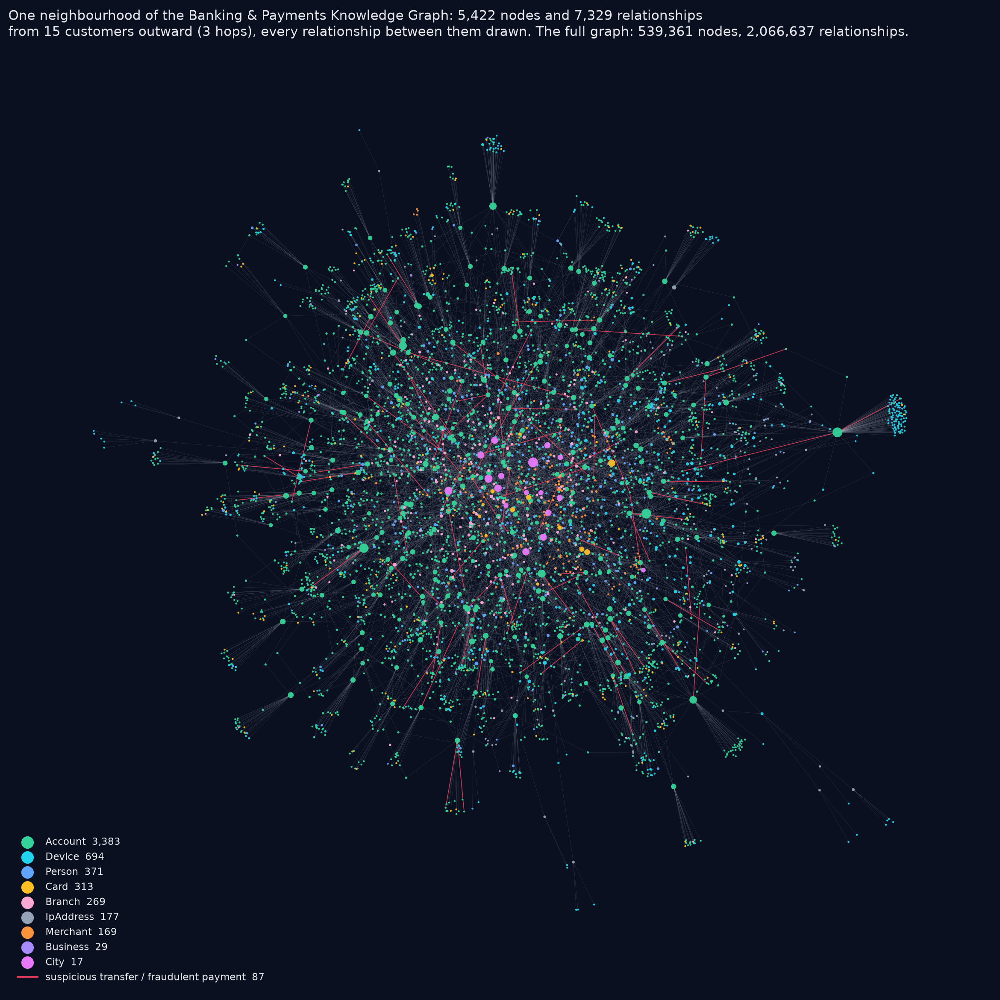
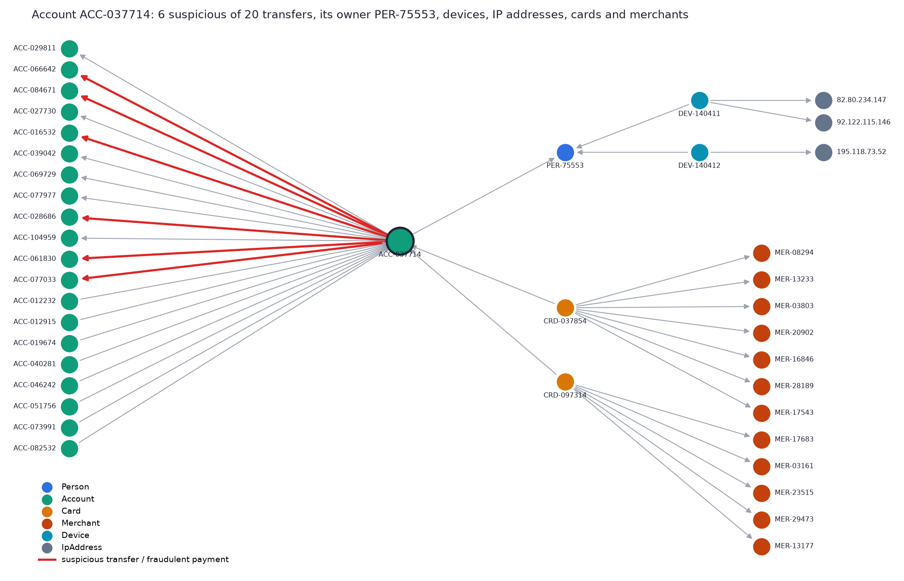
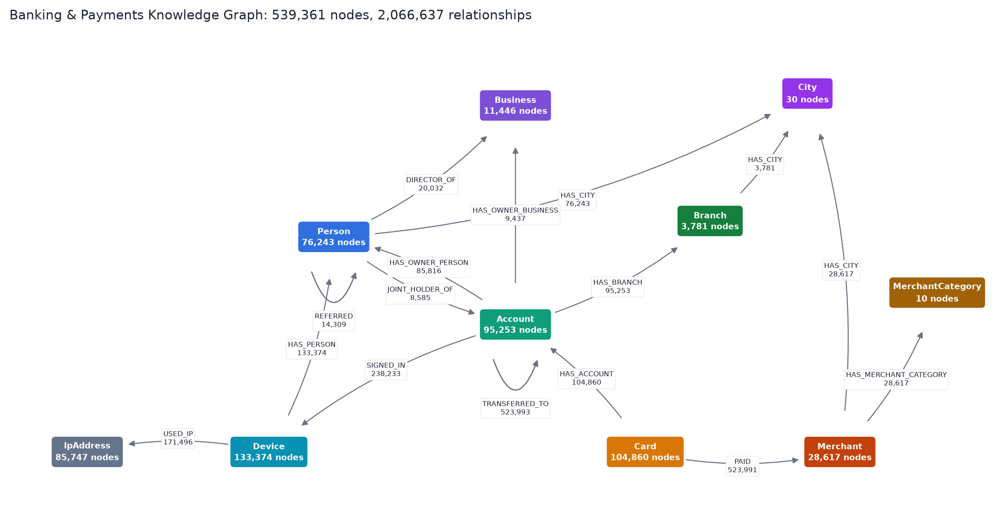

# Bank Fraud & AML Knowledge Graph (Neo4j)

> **Made with [GenerateRealData](https://www.generaterealdata.com?ref=kaggle).** You can create your own realistic datasets like this one in minutes: SQL databases with many linked tables, NoSQL document databases for MongoDB, Firestore, DynamoDB and Elasticsearch, and knowledge graphs for Neo4j and Amazon Neptune. Just describe what you need in plain English, or upload your SQL schema, JSON Schema, MongoDB validator or Cypher schema. IDs match across tables and collections, totals add up, and your business rules hold on every row and every document. With 232 data types and 222 built-in generators, it has one of the largest libraries of any test data generator. **Try it free at [www.generaterealdata.com](https://www.generaterealdata.com?ref=kaggle)**, or write to support@generaterealdata.com.

A US retail bank as a **knowledge graph for Neo4j**: 539,361 nodes with 10 labels and 2,066,637 relationships of 14 types, covering January 2025 to March 2026. People and businesses own accounts, accounts move money to each other, cards pay merchants, customers sign in from devices that connect through IP addresses, and directors run businesses. Every transfer carries an `is_suspicious` flag and every card payment an `is_fraud` flag, both driven by the details of the transaction and of the accounts and people around it. It loads into Neo4j in under a minute with `neo4j-admin`, and every import file is a plain CSV that pandas and NetworkX read directly.

*One real neighbourhood of the graph: 5,422 nodes and 7,329 relationships within three hops of 15 customers, every relationship between them drawn; suspicious transfers and fraudulent payments in red. The full graph has about 100 times as many nodes and 280 times as many relationships.*

## Why this dataset

- A real multi-label graph, not an edge list: people, businesses, accounts, cards, devices, IP addresses, merchants, merchant categories, branches and cities, so questions can follow several hops (who owns the account that sent this, which devices sign in to it, which merchants its cards paid).
- Ready for Neo4j: `neo4j-admin` import files with typed headers, a Cypher load script, a uniqueness constraint per label, and 31 proof queries that all return 0 on the full graph.
- Flags with signal: transfers of 9,000-9,999 USD are flagged suspicious 33.8% of the time against 1.7% for other amounts; transfers from frozen accounts 22.0% against 1.8% from active ones; senders with a high KYC risk rating 9.3% against 2.0% for low; international wires 21.4%. Online card payments are flagged as fraud 3.3% of the time against 0.5% otherwise, and up to 6.5% online at travel, electronics and crypto exchange merchants.
- It behaves like a bank: busy accounts and merchants act as hubs, transfers and payments follow a daily rhythm with lunch and evening peaks, cards are only used while they are valid, and every account has exactly one owner.
- Repeatable: the graph was generated twice from the same design and seed, and both runs were byte-identical.

*One account that sent 6 suspicious transfers (red) out of 20, with everything around it: the accounts it paid and was paid by, its owner, the owner's devices and their IP addresses, its two cards and the merchants they paid.*

**Good for:** Learning Cypher and graph queries; Graph analytics (degree, PageRank, communities, paths); Graph machine learning on node and edge labels; Fraud and AML feature engineering; Knowledge-graph and GraphRAG examples; Testing graph pipelines and Neo4j imports.

## Nodes

| Label | Nodes | What it holds |
|---|---:|---|
| `Person` | 76,243 | Name, date of birth, unique email, phone, KYC risk rating, politically exposed person (PEP) flag, customer since. |
| `Business` | 11,446 | Legal name, industry, state of registration, incorporation date, KYC risk rating. |
| `Account` | 95,253 | Account number, type (checking, savings, business), opened date, status (active, frozen, closed), closed date, balance. |
| `Card` | 104,860 | Masked card number, network, card type, issued date, expiry date. |
| `Device` | 133,374 | Platform and first seen date. |
| `IpAddress` | 85,747 | Address, country and a VPN or proxy flag. |
| `Merchant` | 28,617 | Name. |
| `MerchantCategory` | 10 | Grocery, fuel, restaurants, travel, electronics, clothing, online gambling, crypto exchange, money transfer, utilities. |
| `Branch` | 3,781 | Name. |
| `City` | 30 | US city and state. |

## Relationships

| Relationship | Count | Properties |
|---|---:|---|
| `(Account)-[:TRANSFERRED_TO]->(Account)` | 523,993 | amount, sent_at, channel, is_international, is_suspicious |
| `(Card)-[:PAID]->(Merchant)` | 523,991 | amount, paid_at, channel, is_fraud |
| `(Account)-[:SIGNED_IN]->(Device)` | 238,233 | signed_in_at, success |
| `(Device)-[:USED_IP]->(IpAddress)` | 171,496 | |
| `(Device)-[:HAS_PERSON]->(Person)` | 133,374 | the device's owner |
| `(Card)-[:HAS_ACCOUNT]->(Account)` | 104,860 | |
| `(Account)-[:HAS_BRANCH]->(Branch)` | 95,253 | |
| `(Account)-[:HAS_OWNER_PERSON]->(Person)` | 85,816 | personal accounts |
| `(Account)-[:HAS_OWNER_BUSINESS]->(Business)` | 9,437 | business accounts |
| `(Person)-[:JOINT_HOLDER_OF]->(Account)` | 8,585 | since |
| `(Person)-[:DIRECTOR_OF]->(Business)` | 20,032 | since, ownership_pct |
| `(Person)-[:REFERRED]->(Person)` | 14,309 | referred_at |
| `(Person/Merchant/Branch)-[:HAS_CITY]->(City)` | 108,641 | |
| `(Merchant)-[:HAS_MERCHANT_CATEGORY]->(MerchantCategory)` | 28,617 | |

The three pictures on this page are also in the `visuals` folder (`schema.png`, `flagged_account_neighbourhood.png`, `graph_density.png`).

## Files and loading

- `neo4j/import/nodes/` and `neo4j/import/relationships/`: one CSV per label and per relationship type, with `neo4j-admin` headers (`:ID(Account)`, `amount:double`, `sent_at:datetime`...).
- `neo4j/import.sh` and `import.ps1`: bulk import into an empty, stopped database, then start Neo4j and run `constraints.cypher`. The full graph imports in under a minute.
- `neo4j/load.cypher` with `load.sh` and `load.ps1`: the same graph as a Cypher script for cypher-shell (slower; fine for a laptop).
- `neo4j/proof_queries.cypher`: the 31 rule checks. `neo4j/questions.cypher`: ten questions answered in Cypher. `neo4j/README.md`: counts and properties.

Without Neo4j: read the CSVs with pandas (`pd.read_csv("neo4j/import/relationships/TRANSFERRED_TO__Account__Account.csv")`), drop the type suffix from the column names, and build a NetworkX graph from `:START_ID` and `:END_ID`.

## Rules you can rely on

31 rules were checked inside Neo4j 5 on the full graph and all 31 hold. Each rule is a Cypher query that counts the nodes or relationships breaking it, and every count is 0. The queries are in `neo4j/proof_queries.cypher` and in the [GitHub repository](https://github.com/generaterealdata/synthetic-datasets/tree/main/banking-knowledge-graph).

- Every node key is unique; so are emails and account numbers
- Every account has exactly one owner: a business for business accounts, a person otherwise
- Every account is at one branch, every card on one account, every device owned by one person
- Every person, merchant and branch is in one city; every merchant has one category
- No account sends money to itself; every amount is positive; no balance is negative
- Every transfer is flagged suspicious or not; every card payment fraud or not
- A transfer comes after both accounts were opened; a payment after the card was issued
- A card is issued after its account was opened and expires after it was issued
- A sign-in comes after the account was opened and the device was first seen
- An account is opened after its owner became a customer; a director joins after the business was incorporated
- Closed accounts, and only those, have a closed date, which is after the opened date
- No repeated memberships: a person directs a business once, holds an account jointly once, a device uses an IP address once
- No one refers themselves, and each person is referred at most once

## Questions to try

1. Money moved per month and the share flagged suspicious
2. Structuring: suspicious share by transfer amount band
3. Suspicious share by the sending owner's KYC risk and PEP flag (two hops)
4. Card fraud by merchant category and channel
5. Suspicious share of the transfers frozen, active and closed accounts send
6. Hubs: the accounts that receive money from the most different accounts
7. Exposure: accounts that received money from an account that sent a suspicious transfer
8. Sign-ins from a device that belongs to someone other than the account's holders
9. Money between cities: the city pairs with the most money moved (six hops)
10. People, accounts and suspicious transfers by city

`questions.cypher` answers all ten in Neo4j, and the starter notebook answers them with pandas, showing the Cypher next to each answer.

## Good to know

- Synthetic data from a design, so the graph does not behave like a real bank in every way. The flags follow the transaction and its accounts (amount, international wire, frozen status, the owner's KYC rating and PEP flag, the channel and merchant category), not hidden structures: there are **no planted fraud rings, mule chains or laundering cycles**. For an AML benchmark with laundering patterns as ground truth, see IBM's synthetic AML transactions on Kaggle; this dataset complements it with the people, devices, cards and merchants around the money.
- About 29% of people own no account of their own (directors and referred customers), so about 32% of sign-ins come from a device that belongs to someone other than the account's holders. Use it as a feature, not as a planted takeover signal.
- About 0.4% of transfers involve an account after its closed date: the sending and receiving accounts were open at different times and the transfer kept to the later opening.
- Cards that had expired before 2025 have no payments; about half of the cards are used. 0.3% of payments fall on the card's expiry date itself.
- Customers live in 30 US cities with the design's own weights (Boston has the most), not the real populations.
- Timestamps are UTC (`Z`). Money is in USD. Dates of birth run from 1936 to 2006.
- The node keys are readable ids (`ACC-010001`, `PER-01001`); IP address nodes are keyed by the address itself.

## How it was made

Fully synthetic: generated with [GenerateRealData](https://www.generaterealdata.com/capabilities/?ref=kaggle) in its knowledge graph mode for Neo4j, using a fixed seed. The design (node labels, relationships, properties and rules) was drafted by AI from a plain-English description of a US retail bank; every value was then generated by the engine, which keeps keys, references, time order and the rules above. No field value was written by AI, no real person, business or transaction is in the data, and nothing was edited after generation. The graph was generated twice from the same design and seed, and both runs were byte-identical. The design, the description it came from, the rule checks, the questions, the pictures and a sample of every file are on [GitHub](https://github.com/generaterealdata/synthetic-datasets/tree/main/banking-knowledge-graph).

## Licence

[CC BY 4.0](https://creativecommons.org/licenses/by/4.0/). Use it for anything, including commercial work; please credit "Bank Fraud & AML Knowledge Graph (Neo4j), GenerateRealData" with a link to https://www.generaterealdata.com.
