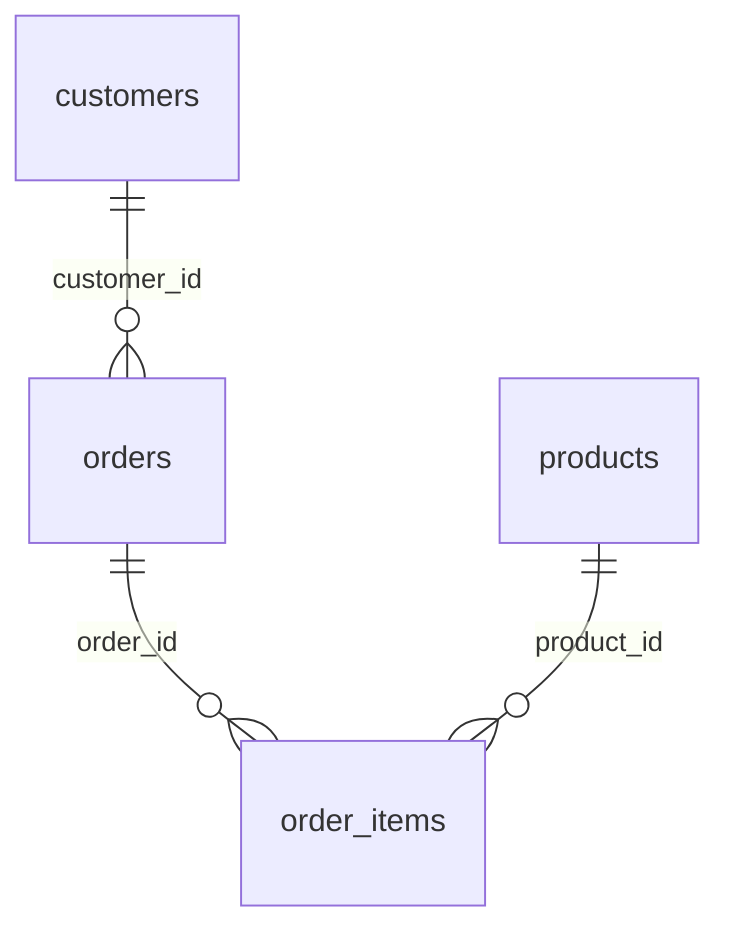

# Dirty E-commerce Data for Cleaning Practice

**250K rows with planted defects, plus the clean version and an answer key.**

The exports of an online shop, 1 January 2025 to 30 September 2026, with about 5% of rows deliberately broken. It comes in two versions generated from the same settings: a clean one where every rule holds, and a dirty one where placeholder text, impossible dates, wrong signs, values ten times too large, blanks and plausible-but-wrong values have been planted. An answer key lists every changed cell, so you can score your own cleaning.

| | |
|---|---|
| Tables | 4 |
| Rows | 250,000 |
| Full data | [Kaggle](https://www.kaggle.com/datasets/generaterealdata/dirty-ecommerce-data-for-cleaning-practice): CSV files and a SQLite database |
| Sample in this folder | [`sample/`](sample/), a connected slice of up to 1,000 rows per table |
| Licence | [CC BY 4.0](../LICENSE): free to use, share and adapt, with credit |
| Made with | [GenerateRealData](https://generaterealdata.com/use-cases/data-quality-testing-data/?ref=github), fully synthetic, no real records |

## What makes it useful

- You can check your work: answer_key.csv gives the table, row, column, original value and planted value of every defect.
- The clean twin is fully consistent (line totals, order totals, shipping dates, country), so every broken rule in the dirty files is a planted defect.
- Defects are the kinds met in real exports: 'N/A', 'UNKNOWN', 'ERROR' and empty strings in text columns; dates of 1900-01-01 and 2099-12-31; negative, zero or tenfold numbers; missing values; and values that look valid but are wrong (another name, another city, a shifted date, a different status).
- Keys are never damaged, so rows can always be matched between the two versions.

**Good for:** Data-cleaning and data-quality practice with a known answer; Testing validation rules, data-quality tools and ETL checks; Teaching anomaly detection on tabular data; Interview and classroom exercises.

## Tables



| Table | Rows | What it holds |
|---|---:|---|
| `customers` | 40,000 | One row per customer. |
| `products` | 2,000 | The catalogue. |
| `orders` | 80,000 | One row per order. |
| `order_items` | 128,000 | One row per product line in an order. |

## The planted defects

11,577 cells differ between the dirty and the clean version. `answer_key.csv` lists each one: table, key, column, clean value, dirty value and kind of defect.

| Table | Rows | Rows with a defect | Share |
|---|---:|---:|---:|
| `customers` | 40,000 | 1,898 | 4.7% |
| `products` | 2,000 | 100 | 5.0% |
| `orders` | 80,000 | 3,179 | 4.0% |
| `order_items` | 128,000 | 6,400 | 5.0% |

| Kind of defect | Cells |
|---|---:|
| ten times too large | 2,205 |
| sign flipped | 2,141 |
| zero | 2,101 |
| plausible but wrong value | 1,530 |
| placeholder text | 1,428 |
| sentinel date | 1,337 |
| empty string | 514 |
| missing value | 321 |

## Rules you can rely on

19 rules were checked on the clean version and all 19 hold. Each rule is a query that counts the rows breaking it, and every count is 0. The queries are in [`checks.sql`](checks.sql).

- customers.customer_id is unique
- customers.email is unique
- products.product_id is unique
- orders.order_id is unique
- order_items.order_item_id is unique
- Every orders.customer_id exists in customers
- Every order_items.order_id exists in orders
- Every order_items.product_id exists in products
- A city never appears under two countries
- Order country is the customer's country
- Order date is never before the customer's signup
- ship_date is empty exactly for pending and cancelled orders
- Shipped 1-5 days after the order
- Item price equals the product's price
- line_total = quantity x unit_price
- Every order has at least one item
- order_total = sum of the order's line totals
- No order or shipment is dated after 2026-09-30
- Email is built from the customer's own name and id

The same queries on the dirty version show what the defects break:

| Rule | Rows breaking it in the dirty version |
|---|---:|
| customers.email is unique | 213 |
| A city never appears under two countries | 50 |
| Order country is the customer's country | 1,306 |
| Order date is never before the customer's signup | 472 |
| ship_date is empty exactly for pending and cancelled orders | 616 |
| Shipped 1-5 days after the order | 1,332 |
| Item price equals the product's price | 3,246 |
| line_total = quantity x unit_price | 6,400 |
| order_total = sum of the order's line totals | 2,149 |
| No order or shipment is dated after 2026-09-30 | 518 |
| Email is built from the customer's own name and id | 217 |

## Column dictionary

The last column is measured from the data (the dirty version, so it shows the planted values).

### `customers` (40,000 rows)

One row per customer.

| Column | Type | Meaning | In this dataset |
|---|---|---|---|
| `customer_id` (PK) | INTEGER | Customer number (primary key; never damaged). | 1 to 40,000 |
| `full_name` | VARCHAR(120) | Full name (fictional). | 33,061 different values, e.g. `Frank Harmon`, `Jill Short` |
| `email` | VARCHAR(160) | Email built from the customer's name and number, at example.com. | 39,787 different values, e.g. `frank.harmon5@example.com`, `jill.short102@example.com` |
| `phone` | VARCHAR(30) | Phone number from a range reserved for fiction; empty for some countries. | 19,471 different values, e.g. `+1-264-555-0133`, `+61 491 570 933`; 32.6% empty |
| `country` | VARCHAR(60) | Country of residence. | `United States` 37.9%, `United Kingdom` 12.1%, `Canada` 9%, `Germany` 8.6%, `France` 6.9%, `Australia` 5.9%, `Spain` 4.1%, `Netherlands` 4% and 8 more |
| `city` | VARCHAR(80) | A real major city of that country. | 55 different values, e.g. `Rotterdam`, `Chicago` |
| `birth_date` | DATE | Date of birth (ages 18-80 in the clean version). | 1900-01-01 to 2099-12-31; 8.3% empty |
| `signup_date` | DATE | Date the account was created. | 1900-01-01 to 2099-12-31 |

### `products` (2,000 rows)

The catalogue.

| Column | Type | Meaning | In this dataset |
|---|---|---|---|
| `product_id` (PK) | INTEGER | Product number (primary key; never damaged). | 1 to 2,000 |
| `product_name` | VARCHAR(120) | Product name; the product type fits the category. | 480 different values, e.g. `Pro Remote Car`, `Premium Puzzle Book` |
| `category` | VARCHAR(40) | Product category. | `Electronics` 14.5%, `Toys` 12.8%, `Sports` 12.4%, `Beauty` 12.4%, `Books` 11.9%, `Home` 11.9%, `Kitchen` 11.8%, `Garden` 11.4% and 4 more |
| `unit_price` | NUMERIC(10,2) | Selling price. | -147.95 to 1,587.1 |
| `stock_qty` | INTEGER | Units in stock (0-500 in the clean version). | -431 to 3,830 |

### `orders` (80,000 rows)

One row per order.

| Column | Type | Meaning | In this dataset |
|---|---|---|---|
| `order_id` (PK) | INTEGER | Order number (primary key; never damaged). | 1 to 80,000 |
| `customer_id` → `customers.customer_id` | INTEGER | The customer who placed the order. | 1 to 40,000 |
| `order_date` | DATE | Order date; never before the customer's signup in the clean version. | 1900-01-01 to 2100-02-23 |
| `ship_date` | DATE | 1-5 days after order_date; empty for pending and cancelled orders in the clean version. | 1900-01-01 to 2099-12-31; 18.1% empty |
| `status` | VARCHAR(12) | Order status. | `delivered` 69.9%, `shipped` 12.2%, `cancelled` 10%, `pending` 7.9% |
| `order_total` | NUMERIC(12,2) | Sum of the order's line totals in the clean version. | 4.03 to 4,113.8 |
| `country` | VARCHAR(60) | The customer's country in the clean version. | `United States` 38.1%, `United Kingdom` 11.9%, `Canada` 8.9%, `Germany` 8.5%, `France` 6.9%, `Australia` 5.9%, `Spain` 4.1%, `Netherlands` 3.9% and 8 more |

### `order_items` (128,000 rows)

One row per product line in an order.

| Column | Type | Meaning | In this dataset |
|---|---|---|---|
| `order_item_id` (PK) | INTEGER | Line number (primary key; never damaged). | 1 to 128,000 |
| `order_id` → `orders.order_id` | INTEGER | The order this line belongs to. | 1 to 80,000 |
| `product_id` → `products.product_id` | INTEGER | The product bought. | 1 to 2,000 |
| `quantity` | INTEGER | Units bought (1-5 in the clean version). | `1` 63%, `2` 21.6%, `3` 7.8%, `4` 4%, `5` 2%, `0` 0.5%, `10` 0.4%, `-1` 0.3% and 8 more |
| `unit_price` | NUMERIC(10,2) | Price per unit; the product's price in the clean version. | -546.98 to 5,874.8 |
| `line_total` | NUMERIC(12,2) | quantity x unit_price in the clean version. | -1,583.92 to 16,430.5 |

## Questions to try

**How many placeholder values hide in each customer text column?**

```sql
SELECT 'full_name' AS col, SUM(full_name IN ('', 'N/A', 'UNKNOWN', 'ERROR')) AS placeholders FROM customers
UNION ALL SELECT 'email', SUM(email IN ('', 'N/A', 'UNKNOWN', 'ERROR')) FROM customers
UNION ALL SELECT 'country', SUM(country IN ('', 'N/A', 'UNKNOWN', 'ERROR')) FROM customers
UNION ALL SELECT 'city', SUM(city IN ('', 'N/A', 'UNKNOWN', 'ERROR')) FROM customers;
```

**Emails that are not valid addresses**

```sql
SELECT email, COUNT(*) AS n FROM customers
WHERE email NOT LIKE '%_@_%._%' GROUP BY email ORDER BY n DESC;
```

**Impossible dates: sentinel values and customers born in the future**

```sql
SELECT SUM(birth_date IN ('1900-01-01', '2099-12-31')) AS sentinel_birth_dates,
       SUM(signup_date IN ('1900-01-01', '2099-12-31')) AS sentinel_signup_dates,
       SUM(birth_date > signup_date) AS born_after_signup
FROM customers;
```

Seven more are in [`questions.sql`](questions.sql). All ten run as written on the SQLite file.

## Good to know

- Defects are planted in single cells; there are no duplicated or deleted rows.
- Some planted values look valid on their own (a real city in the wrong country, a date a few weeks off); only a cross-check or the answer key reveals them.
- Names are English-style for every country.
- Yes/no columns hold 1 and 0. Empty cells in the CSV files mean no value (NULL in the database files).
- The CSV files are UTF-8. Dates are `YYYY-MM-DD` and timestamps `YYYY-MM-DD HH:MM:SS`.

## Files

| File | What it is |
|---|---|
| `schema.sql` | The `CREATE TABLE` statements (PostgreSQL syntax) the data was generated from |
| `generation.json` | Settings of the run: seed, rows per table, options |
| `plan.json` | The full generation plan: one rule set per column |
| `checks.sql` | One query per rule above; each returns 0 on the full dataset |
| `questions.sql` | Ten practice questions with their queries |
| `sample/` | `customers.csv` 303 rows; `products.csv` 533 rows; `orders.csv` 614 rows; `order_items.csv` 999 rows |

`sample/` also holds the same rows from the clean version (`*_clean.csv`) and the matching lines of `answer_key.csv`.

## Re-create it

The dataset is reproducible. With a GenerateRealData API key, [`scripts/recreate.py`](../scripts/recreate.py) sends `plan.json`, `schema.sql` and the seed `20261103` to the API and downloads the same data:

```bash
python scripts/recreate.py dirty-ecommerce
```

To build your own version, change the row counts or rules, or start from your own schema: [generaterealdata.com/use-cases/data-quality-testing-data/](https://generaterealdata.com/use-cases/data-quality-testing-data/?ref=github).

## How it was made

Fully synthetic: generated with [GenerateRealData](https://generaterealdata.com/use-cases/data-quality-testing-data/?ref=github) from a database schema and a set of rules, using a fixed seed. No real person, company or transaction is in the data, and no value was edited after generation. No field was written by AI. 

## Licence

[CC BY 4.0](https://creativecommons.org/licenses/by/4.0/). Use it for anything, including commercial work; please credit "Dirty E-commerce Data for Cleaning Practice, GenerateRealData" with a link to https://generaterealdata.com.
