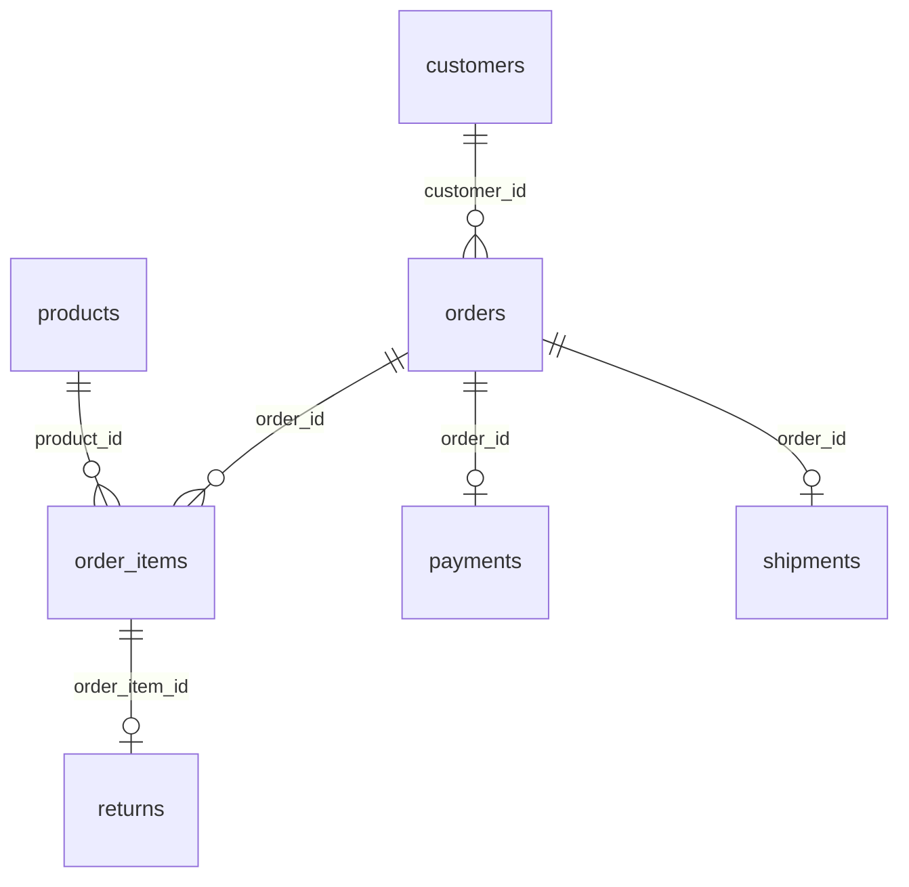

# Synthetic E-commerce Database

**500K rows of orders, items, payments, shipments and returns that add up.**

An online outdoor-gear store, from 1 January 2024 to 30 September 2026. Customers in twelve countries buy tents, boots and backpacks through the web shop, the app, a marketplace and a physical store. Seven tables hold the whole order lifecycle: who bought, what was in the basket, how it was paid, when it shipped and what came back.

| | |
|---|---|
| Tables | 7 |
| Rows | 499,385 |
| Full data | [Kaggle](https://www.kaggle.com/datasets/generaterealdata/synthetic-ecommerce-database): CSV files and a SQLite database |
| Sample in this folder | [`sample/`](sample/), a connected slice of up to 1,000 rows per table |
| Licence | [CC BY 4.0](../LICENSE): free to use, share and adapt, with credit |
| Made with | [GenerateRealData](https://generaterealdata.com/use-cases/relational-database-test-data/), fully synthetic, no real records |

## What makes it useful

- Money adds up at every level: line total = quantity x price, order subtotal = sum of its lines, tax and total follow from it, and the payment equals the order total.
- Statuses agree across tables: a cancelled order has no shipment and a refunded or failed payment; a returned order has a refunded payment and its returns point at its own items.
- Realistic shape: a few loyal customers place many orders, sales peak in November and December and grow year over year, and only the most recent orders are still processing or in transit.
- Safe by construction: emails use example.com and phone numbers come only from ranges reserved for fiction.

**Good for:** SQL practice with real joins (up to five tables deep); Testing a shop, order or billing application; BI dashboards: revenue, repeat purchase, return rate, delivery time; Teaching database design and data modelling.

## Tables



| Table | Rows | What it holds |
|---|---:|---|
| `customers` | 26,000 | One row per registered customer. |
| `products` | 1,500 | The catalogue: one row per product. |
| `orders` | 90,000 | One row per order, with its money columns. |
| `order_items` | 200,000 | One row per product line in an order. Every order has between 1 and 12 lines. |
| `payments` | 90,000 | Exactly one payment per order. |
| `shipments` | 83,885 | One shipment for every shipped, delivered or returned order; none for processing or cancelled orders. |
| `returns` | 8,000 | Returned order lines. Only lines of orders with status returned appear, each at most once. |

## Rules you can rely on

48 rules were checked on the full dataset and all 48 hold. Each rule is a query that counts the rows breaking it, and every count is 0. The queries are in [`checks.sql`](checks.sql).

- customers.customer_id is unique
- customers.email is unique
- products.product_id is unique
- products.sku is unique
- orders.order_id is unique
- order_items.order_item_id is unique
- shipments.tracking_number is unique
- Every orders.customer_id exists in customers
- Every order_items.order_id exists in orders
- Every order_items.product_id exists in products
- Every payments.order_id exists in orders
- Every shipments.order_id exists in orders
- Every returns.order_item_id exists in order_items
- A city never appears under two countries
- Every order is in USD
- Order date is never before the customer's signup
- Item price equals the product's price
- line_total = quantity x unit_price
- Every order has at least one item
- Subtotal = sum of the order's line totals
- Discount is 0 to 20% of subtotal
- Tax = 8% of (subtotal - discount)
- Total = subtotal - discount + shipping + tax
- Shipping is free from 75, else 4.99-9.99
- Every order has exactly one payment
- Payment amount equals the order total
- Payment status follows the order status
- Shipments exist only for shipped, delivered or returned orders
- Every shipped, delivered or returned order has exactly one shipment
- Shipment status follows the order status
- Shipped 1-3 days after the order
- delivered_at is empty exactly while in transit
- Delivered 2-9 days after shipping
- Returns only for items of returned orders
- returns.order_item_id is unique
- Refund never exceeds the line total
- unit_cost is 35-70% of unit_price
- No order is dated after 2026-09-30
- No shipment or delivery is dated after 2026-09-30
- No return is requested after 2026-09-30
- Only orders from the last 12 days are still processing or in transit
- Orders are returned only if placed before September 2026
- Orders peak in November and December (at least 1.5 times an average month)
- Each year has more orders per month than the year before
- No order has more than 12 line items
- Every product name is unique
- Email is built from the customer's own name
- Phone numbers use only ranges reserved for fiction

## Column dictionary

The last column is measured from the data.

### `customers` (26,000 rows)

One row per registered customer.

| Column | Type | Meaning | In this dataset |
|---|---|---|---|
| `customer_id` (PK) | INTEGER | Customer number (primary key). | 1 to 26,000 |
| `first_name` | VARCHAR(60) | Given name (fictional). | 688 different values, e.g. `Brent`, `Tiffany` |
| `last_name` | VARCHAR(60) | Family name (fictional). | 1,000 different values, e.g. `Mayer`, `James` |
| `email` | VARCHAR(160) | Unique email built from the customer's own name and number, always at example.com. | 26,000 different values, e.g. `adam.douglas11451@example.com`, `adam.elliott8153@example.com` |
| `phone` | VARCHAR(30) | Phone number from a range reserved for fiction (US/Canada 555-01xx, UK 07700 900xxx, Ireland 020 91x, Australia 0491 570 xxx); empty for other countries. | 13,529 different values, e.g. `+1-514-555-0123`, `+353 20 913 1966`; 33.2% empty |
| `country` | VARCHAR(60) | Country of residence. | `United States` 38.5%, `United Kingdom` 11.9%, `Germany` 8.9%, `Canada` 8.7%, `France` 7.1%, `Australia` 5.8%, `Netherlands` 4.1%, `Italy` 4.1% and 4 more |
| `city` | VARCHAR(80) | A real major city of that country. | 51 different values, e.g. `Houston`, `Limerick` |
| `signup_date` | DATE | Date the account was created; always before the customer's first order. | 2021-06-01 to 2023-12-30 |
| `loyalty_tier` | VARCHAR(10) | Loyalty programme tier. | `none` 70.1%, `silver` 17.1%, `gold` 9.8%, `platinum` 3% |
| `marketing_opt_in` | BOOLEAN | Whether the customer agreed to marketing email (1 = yes). | `0` 59.7%, `1` 40.3% |

### `products` (1,500 rows)

The catalogue: one row per product.

| Column | Type | Meaning | In this dataset |
|---|---|---|---|
| `product_id` (PK) | INTEGER | Product number (primary key). | 1 to 1,500 |
| `sku` | VARCHAR(20) | Unique stock code, OUT-00001 onwards. | 1,500 different values, e.g. `OUT-00005`, `OUT-00102` |
| `product_name` | VARCHAR(120) | Unique name: model line, product type and colour, e.g. 'Ridge 45L Backpack (Cobalt)'. The type always fits the category. | 1,500 different values, e.g. `Tundra Camp Lantern (Cobalt)`, `Solstice Dynamic Rope (Moss)` |
| `category` | VARCHAR(40) | Product category. | `Accessories` 13.4%, `Apparel` 12.6%, `Footwear` 10.7%, `Tents` 10.1%, `Climbing` 9.9%, `Cooking` 9.8%, `Backpacks` 9.6%, `Lighting` 8.3% and 2 more |
| `brand` | VARCHAR(60) | One of twelve invented outdoor brands. | `Kestrel & Co` 9.9%, `Ravenridge` 9%, `Wildhaven` 8.5%, `Larkspur` 8.5%, `Cairnworks` 8.5%, `Ironwood Trail` 8.5%, `Northpeak` 8.1%, `Bluecrest` 8.1% and 4 more |
| `unit_price` | NUMERIC(10,2) | Current selling price in USD; price range depends on the category. | 8.15 to 881.01 |
| `unit_cost` | NUMERIC(10,2) | Purchase cost in USD, always 35-70% of unit_price. | 3.18 to 556.86 |
| `weight_kg` | NUMERIC(6,2) | Shipping weight in kilograms; empty for a few products. | 0.1 to 5; 5.2% empty |
| `is_active` | BOOLEAN | Whether the product is still on sale (1 = yes). | `1` 92.3%, `0` 7.7% |
| `created_at` | DATE | Date the product was added to the catalogue. | 2021-01-01 to 2023-12-29 |

### `orders` (90,000 rows)

One row per order, with its money columns.

| Column | Type | Meaning | In this dataset |
|---|---|---|---|
| `order_id` (PK) | INTEGER | Order number (primary key). | 1 to 90,000 |
| `customer_id` → `customers.customer_id` | INTEGER | The customer who placed the order. | 1 to 26,000 |
| `order_date` | TIMESTAMP | Date and time of the order; never before the customer's signup_date. | 2024-01-01 00:08:26 to 2026-09-29 23:22:24 |
| `status` | VARCHAR(12) | Where the order stands. Only orders from the last 12 days are still processing or shipped. | `delivered` 85.2%, `returned` 7.2%, `cancelled` 6.5%, `shipped` 0.8%, `processing` 0.3% |
| `channel` | VARCHAR(12) | Sales channel. | `web` 45.9%, `app` 34.1%, `marketplace` 14.2%, `store` 5.9% |
| `subtotal` | NUMERIC(12,2) | Sum of the order's line totals. | 8.15 to 8,906.44 |
| `discount_amount` | NUMERIC(12,2) | Discount in USD: 0 for most orders, otherwise up to 20% of subtotal. | 0 to 1,252.28 |
| `shipping_fee` | NUMERIC(8,2) | 0 when subtotal is 75 or more, otherwise 4.99-9.99. | 0 to 9.99 |
| `tax_amount` | NUMERIC(12,2) | 8% of (subtotal - discount_amount). | 0.56 to 712.52 |
| `total_amount` | NUMERIC(12,2) | subtotal - discount_amount + shipping_fee + tax_amount. | 13.55 to 9,618.96 |
| `currency` | CHAR(3) | Always USD. | `USD` 100% |

### `order_items` (200,000 rows)

One row per product line in an order. Every order has between 1 and 12 lines.

| Column | Type | Meaning | In this dataset |
|---|---|---|---|
| `order_item_id` (PK) | INTEGER | Line number (primary key). | 1 to 200,000 |
| `order_id` → `orders.order_id` | INTEGER | The order this line belongs to. | 1 to 90,000 |
| `product_id` → `products.product_id` | INTEGER | The product bought. | 1 to 1,500 |
| `quantity` | INTEGER | Units bought. | `1` 61.9%, `2` 24%, `3` 6.1%, `4` 4%, `5` 2%, `6` 2% |
| `unit_price` | NUMERIC(10,2) | Price per unit; equals the product's unit_price. | 8.15 to 881.01 |
| `line_total` | NUMERIC(12,2) | quantity x unit_price. | 8.15 to 5,286.06 |

### `payments` (90,000 rows)

Exactly one payment per order.

| Column | Type | Meaning | In this dataset |
|---|---|---|---|
| `payment_id` (PK) | INTEGER | Payment number (primary key). | 1 to 90,000 |
| `order_id` → `orders.order_id` | INTEGER | The order paid for (each order appears once). | 1 to 90,000 |
| `method` | VARCHAR(16) | Payment method. | `card` 51.9%, `paypal` 20.1%, `apple_pay` 11%, `google_pay` 8%, `klarna` 5%, `bank_transfer` 4% |
| `amount` | NUMERIC(12,2) | Equals the order's total_amount. | 13.55 to 9,618.96 |
| `paid_at` | TIMESTAMP | Equals the order's order_date. | 2024-01-01 00:08:26 to 2026-09-29 23:22:24 |
| `status` | VARCHAR(10) | captured for normal orders; refunded for returned orders; refunded or failed for cancelled orders. | `captured` 86.3%, `refunded` 11.8%, `failed` 1.9% |

### `shipments` (83,885 rows)

One shipment for every shipped, delivered or returned order; none for processing or cancelled orders.

| Column | Type | Meaning | In this dataset |
|---|---|---|---|
| `shipment_id` (PK) | INTEGER | Shipment number (primary key). | 1 to 83,885 |
| `order_id` → `orders.order_id` | INTEGER | The order shipped (each order appears at most once). | 1 to 90,000 |
| `carrier` | VARCHAR(30) | Delivery company. | `UPS` 26.1%, `FedEx` 21.9%, `DHL` 17.7%, `USPS` 16.2%, `Royal Mail` 8.1%, `DPD` 6%, `Canada Post` 4.1% |
| `tracking_number` | VARCHAR(30) | Unique tracking code: two letters, nine digits, two letters. | 83,885 different values, e.g. `AA611872731YK`, `AB797768825FQ` |
| `shipped_at` | TIMESTAMP | 1-3 days after the order date. | 2024-01-02 00:00:00 to 2026-09-30 00:00:00 |
| `delivered_at` | TIMESTAMP | 2-9 days after shipped_at; empty while in transit. | 2024-01-04 00:00:00 to 2026-09-30 00:00:00; 0.9% empty |
| `status` | VARCHAR(12) | in_transit when the order status is shipped, otherwise delivered. | `delivered` 99.1%, `in_transit` 0.9% |

### `returns` (8,000 rows)

Returned order lines. Only lines of orders with status returned appear, each at most once.

| Column | Type | Meaning | In this dataset |
|---|---|---|---|
| `return_id` (PK) | INTEGER | Return number (primary key). | 1 to 8,000 |
| `order_item_id` → `order_items.order_item_id` | INTEGER | The order line that was returned. | 86 to 199,984 |
| `reason` | VARCHAR(20) | Why it was returned. | `wrong_size` 29.6%, `changed_mind` 23.2%, `not_as_described` 21%, `damaged` 16.1%, `arrived_late` 10.1% |
| `refund_amount` | NUMERIC(12,2) | Refund in USD; never more than the line total. | 4.12 to 4,503.93 |
| `requested_at` | TIMESTAMP | Date the return was requested. | 2024-01-04 00:00:00 to 2026-09-20 00:00:00 |
| `status` | VARCHAR(10) | Where the return stands. | `refunded` 70.5%, `approved` 14.9%, `requested` 9.9%, `rejected` 4.7% |

## Questions to try

**Monthly revenue and order count**

```sql
SELECT substr(order_date, 1, 7) AS month, COUNT(*) AS orders, ROUND(SUM(total_amount), 2) AS revenue
FROM orders WHERE status <> 'cancelled'
GROUP BY month ORDER BY month;
```

**Top 10 customers by lifetime spend**

```sql
SELECT c.customer_id, c.first_name || ' ' || c.last_name AS customer, c.country,
       COUNT(*) AS orders, ROUND(SUM(o.total_amount), 2) AS spend
FROM orders o JOIN customers c USING (customer_id)
WHERE o.status <> 'cancelled'
GROUP BY c.customer_id ORDER BY spend DESC LIMIT 10;
```

**Revenue and gross margin by category**

```sql
SELECT p.category, ROUND(SUM(i.line_total), 2) AS revenue,
       ROUND(100.0 * SUM(i.line_total - i.quantity * p.unit_cost) / SUM(i.line_total), 1) AS margin_pct
FROM order_items i JOIN products p USING (product_id) JOIN orders o USING (order_id)
WHERE o.status NOT IN ('cancelled', 'returned')
GROUP BY p.category ORDER BY revenue DESC;
```

Seven more are in [`questions.sql`](questions.sql). All ten run as written on the SQLite file.

## Good to know

- Names are English-style for every country.
- Shipment, delivery and return times are whole days (stored at 00:00:00).
- Product weight does not depend on the product type.
- Yes/no columns hold 1 and 0. Empty cells in the CSV files mean no value (NULL in the database files).
- The CSV files are UTF-8. Dates are `YYYY-MM-DD` and timestamps `YYYY-MM-DD HH:MM:SS`.

## Files

| File | What it is |
|---|---|
| `schema.sql` | The `CREATE TABLE` statements (PostgreSQL syntax) the data was generated from |
| `generation.json` | Settings of the run: seed, rows per table, options |
| `plan.json` | The full generation plan: one rule set per column |
| `checks.sql` | One query per rule above; each returns 0 on the full dataset |
| `questions.sql` | Ten practice questions with their queries |
| `sample/` | `customers.csv` 116 rows; `products.csv` 506 rows; `orders.csv` 442 rows; `order_items.csv` 990 rows; `payments.csv` 442 rows; `shipments.csv` 410 rows; `returns.csv` 47 rows |

## Re-create it

The dataset is reproducible. With a GenerateRealData API key, [`scripts/recreate.py`](../scripts/recreate.py) sends `plan.json`, `schema.sql` and the seed `20261101` to the API and downloads the same data:

```bash
python scripts/recreate.py ecommerce
```

To build your own version, change the row counts or rules, or start from your own schema: [generaterealdata.com/use-cases/relational-database-test-data/](https://generaterealdata.com/use-cases/relational-database-test-data/).

## How it was made

Fully synthetic: generated with [GenerateRealData](https://generaterealdata.com/use-cases/relational-database-test-data/) from a database schema and a set of rules, using a fixed seed. No real person, company or transaction is in the data, and no value was edited after generation. No field was written by AI. 

## Licence

[CC BY 4.0](https://creativecommons.org/licenses/by/4.0/). Use it for anything, including commercial work; please credit "Synthetic E-commerce Database, GenerateRealData" with a link to https://generaterealdata.com.
