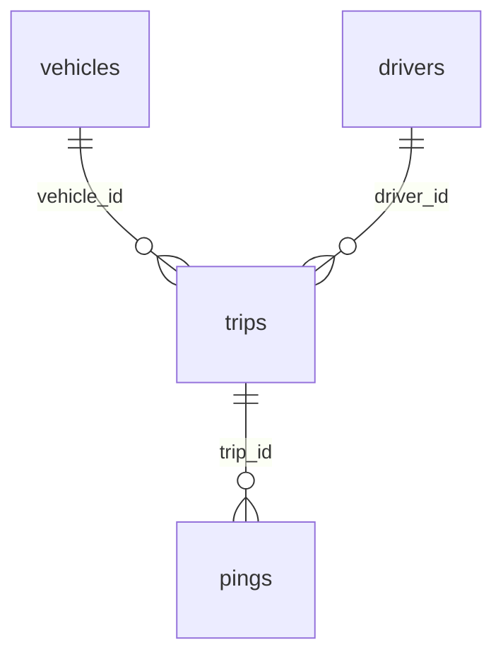

# Synthetic Fleet GPS Tracking

**400K GPS pings on 6,000 delivery trips, with speed, heading and odometer.**

A delivery fleet of 200 vans and 300 drivers working from five depots in Chicago's western suburbs during September 2026. Each of the 6,000 trips is a continuous track of GPS pings 30 seconds apart: position, speed, heading, odometer and geofence events from leaving the depot to coming back.

| | |
|---|---|
| Tables | 4 |
| Rows | 404,052 |
| Full data | [Kaggle](https://www.kaggle.com/datasets/generaterealdata/synthetic-fleet-gps-tracking): CSV files and a SQLite database |
| Sample in this folder | [`sample/`](sample/), a connected slice of up to 1,000 rows per table |
| Licence | [CC BY 4.0](../LICENSE): free to use, share and adapt, with credit |
| Made with | [GenerateRealData](https://generaterealdata.com/use-cases/geospatial-tracking-data/?ref=github), fully synthetic, no real records |

## What makes it useful

- The track is physically consistent: between two pings the position moves by exactly speed x 30 seconds in the direction of the heading, and the odometer grows by the same distance.
- Trips are stories: the first ping is the depot exit at the trip's start time, within 1 km of the vehicle's own depot; vans stand still at customer stops, slow down in school zones, and nothing is recorded after re-entering a depot.
- Trip summaries are derived from the pings: ping count, duration, distance and number of stops equal what the trip's pings show.
- No jumps, no gaps, no U-turns between pings, and every position stays on land west of the Lake Michigan shore.

**Good for:** Geospatial and trajectory analysis practice; Testing fleet-tracking, telematics and mapping software; Stop detection, geofencing and trip-summarisation exercises; SQL window functions over ordered events.

## Tables



| Table | Rows | What it holds |
|---|---:|---|
| `vehicles` | 200 | The 200 delivery vans. |
| `drivers` | 300 | The 300 drivers. |
| `trips` | 6,000 | One row per trip, with totals derived from its pings. |
| `pings` | 397,552 | One GPS fix every 30 seconds of every trip. |

## Rules you can rely on

30 rules were checked on the full dataset and all 30 hold. Each rule is a query that counts the rows breaking it, and every count is 0. The queries are in [`checks.sql`](checks.sql).

- vehicles.vehicle_id is unique
- vehicles.vin is unique
- vehicles.plate_number is unique
- drivers.license_no is unique
- trips.trip_id is unique
- pings.ping_id is unique
- Every trips.vehicle_id exists in vehicles
- Every trips.driver_id exists in drivers
- Every pings.trip_id exists in trips
- VINs are 17 characters without I, O or Q
- A model always belongs to the same make
- Electric models are electric
- Every vehicle has trips
- Every trip has pings
- A trip's first ping is at its start time and is the depot exit
- Pings are exactly 30 seconds apart within a trip
- The odometer grows by exactly speed x 30 seconds
- The odometer never goes backwards within a trip
- Position moves by speed x 30 seconds in the direction of the heading
- Heading letter and degrees agree
- Trips last between 1 and 60 minutes
- Vans never make a U-turn between pings
- Every trip starts within 1 km of its vehicle's depot
- All pings stay on land west of the Lake Michigan shore
- Vans stand still at customer stops
- School zones are driven at 25 km/h or less
- Speed is 0-90 km/h
- Nothing is recorded after a van re-enters the depot
- Trip ping_count, duration and stops equal what its pings show
- Trip distance equals the distance its pings add up to

## Column dictionary

The last column is measured from the data.

### `vehicles` (200 rows)

The 200 delivery vans.

| Column | Type | Meaning | In this dataset |
|---|---|---|---|
| `vehicle_id` (PK) | INTEGER | Vehicle number (primary key). | 1 to 200 |
| `plate_number` | VARCHAR(10) | Unique licence plate (invented format). | 200 different values, e.g. `GJ 47085`, `MJ 98032` |
| `vin` | CHAR(17) | Unique 17-character vehicle identification number (never uses I, O or Q). | 200 different values, e.g. `08GLY50J767D0BJXH`, `GG6AJKCX3DVXUJJAL` |
| `make` | VARCHAR(30) | Manufacturer; always matches the model. | `Ford` 34%, `Ram` 18%, `Mercedes-Benz` 17.5%, `Chevrolet` 13%, `Nissan` 7%, `Rivian` 5.5%, `Isuzu` 5% |
| `model` | VARCHAR(30) | Van model. | `Transit` 26%, `ProMaster` 18%, `Sprinter` 17.5%, `Express` 13%, `E-Transit` 8%, `NV200` 7%, `EDV` 5.5%, `NPR` 5% |
| `model_year` | INTEGER | Model year. | `2025` 16.5%, `2024` 16.5%, `2022` 13%, `2018` 11%, `2023` 10%, `2021` 9%, `2019` 7%, `2026` 6.5% and 2 more |
| `fuel_type` | VARCHAR(10) | diesel, petrol or electric; E-Transit and EDV are always electric. | `petrol` 46.5%, `diesel` 40%, `electric` 13.5% |
| `depot` | VARCHAR(30) | Home depot: Elmhurst, Schaumburg, Naperville, Oak Brook or Bolingbrook. | `Oak Brook` 25.5%, `Elmhurst` 21%, `Schaumburg` 18%, `Naperville` 18%, `Bolingbrook` 17.5% |

### `drivers` (300 rows)

The 300 drivers.

| Column | Type | Meaning | In this dataset |
|---|---|---|---|
| `driver_id` (PK) | INTEGER | Driver number (primary key). | 1 to 300 |
| `full_name` | VARCHAR(120) | Full name (fictional). | 300 different values, e.g. `Stephanie Baker`, `Angela Brown` |
| `license_no` | VARCHAR(20) | Unique driving-licence number (invented format). | 300 different values, e.g. `G434-9229-1235`, `G613-3338-4037` |
| `hired_on` | DATE | Hire date. | 2012-01-02 to 2026-05-04 |
| `rating` | NUMERIC(2,1) | Driver rating from 3.0 to 5.0. | `4.5` 12.3%, `4.2` 12%, `4.4` 11.7%, `4.3` 9%, `4` 7.7%, `4.6` 7%, `4.7` 6.7%, `4.8` 6.3% and 8 more |

### `trips` (6,000 rows)

One row per trip, with totals derived from its pings.

| Column | Type | Meaning | In this dataset |
|---|---|---|---|
| `trip_id` (PK) | INTEGER | Trip number (primary key). | 1 to 6,000 |
| `vehicle_id` → `vehicles.vehicle_id` | INTEGER | The van driven. Every vehicle has trips. | 1 to 200 |
| `driver_id` → `drivers.driver_id` | INTEGER | The driver. | 1 to 300 |
| `started_at` | TIMESTAMP | When the van left the depot; the time of the trip's first ping. | 2026-09-01 00:06:50 to 2026-09-29 23:54:32 |
| `ping_count` | INTEGER | Number of pings recorded on the trip. | 3 to 120 |
| `duration_min` | NUMERIC(6,1) | Trip length in minutes = ping_count x 0.5. | 1.5 to 60 |
| `distance_km` | NUMERIC(7,2) | Distance driven = the sum of speed x 30 seconds over the trip's pings. | 0.27 to 47.22 |
| `stops` | INTEGER | Number of customer stops = the trip's customer_stop pings. | `0` 38.2%, `1` 26.3%, `2` 17.7%, `3` 10.3%, `4` 4.4%, `5` 2%, `6` 0.6%, `7` 0.3% and 2 more |

### `pings` (397,552 rows)

One GPS fix every 30 seconds of every trip.

| Column | Type | Meaning | In this dataset |
|---|---|---|---|
| `ping_id` (PK) | INTEGER | Ping number (primary key). | 1 to 397,552 |
| `trip_id` → `trips.trip_id` | INTEGER | The trip the ping belongs to. | 1 to 6,000 |
| `recorded_at` | TIMESTAMP | Time of the fix; exactly 30 seconds after the previous ping of the trip. | 2026-09-01 00:06:50 to 2026-09-30 00:54:02 |
| `latitude` | NUMERIC(9,6) | Latitude in decimal degrees (six decimals). | 41.53 to 42.1669 |
| `longitude` | NUMERIC(9,6) | Longitude in decimal degrees (six decimals). | -88.429 to -87.7289 |
| `speed_kmh` | NUMERIC(5,1) | Speed in km/h: 0 at customer stops, at most 25 in school zones, never above 90. | 0 to 85.7 |
| `heading` | CHAR(1) | Direction of travel as a compass letter: N, E, S or W. | `W` 25.1%, `N` 25%, `E` 25%, `S` 24.9% |
| `heading_deg` | INTEGER | The same direction in degrees: 0, 90, 180 or 270. | `270` 25.1%, `0` 25%, `90` 25%, `180` 24.9% |
| `odometer_km` | NUMERIC(10,3) | Odometer reading in km; grows by speed x 30 seconds from ping to ping. | 8,020.14 to 179,991.82 |
| `geofence_event` | VARCHAR(14) | none for most pings; otherwise depot_exit (always the first ping), customer_stop, school_zone or depot_enter (which ends the trip). | `none` 94.4%, `customer_stop` 1.9%, `depot_exit` 1.5%, `depot_enter` 1.1%, `school_zone` 1% |

## Questions to try

**Trips, distance and driving time per depot**

```sql
SELECT v.depot, COUNT(*) AS trips, ROUND(SUM(t.distance_km), 1) AS km, ROUND(SUM(t.duration_min) / 60, 1) AS hours
FROM trips t JOIN vehicles v USING (vehicle_id) GROUP BY v.depot ORDER BY km DESC;
```

**Average speed by hour of day**

```sql
SELECT CAST(strftime('%H', recorded_at) AS INTEGER) AS hour, ROUND(AVG(speed_kmh), 1) AS avg_speed_kmh, COUNT(*) AS pings
FROM pings GROUP BY hour ORDER BY hour;
```

**The ten longest trips**

```sql
SELECT t.trip_id, v.model, d.full_name AS driver, t.duration_min, t.distance_km, t.stops
FROM trips t JOIN vehicles v USING (vehicle_id) JOIN drivers d USING (driver_id)
ORDER BY t.distance_km DESC LIMIT 10;
```

Seven more are in [`questions.sql`](questions.sql). All ten run as written on the SQLite file.

## Good to know

- Vans move on a compass grid (north, east, south or west only), not along real streets, so tracks will not match a road map.
- Trips start at any hour of the day and last at most 60 minutes. About three in four end with a depot_enter ping; the rest are cut off at the 60-minute mark. The depot entered is not necessarily the one the van left.
- A vehicle's odometer starts each trip at an unrelated reading, so it is continuous within a trip but not across trips.
- Every customer stop is a single 30-second ping, so dwell times do not vary.
- Drivers are assigned to trips independently of vehicle and depot.
- Yes/no columns hold 1 and 0. Empty cells in the CSV files mean no value (NULL in the database files).
- The CSV files are UTF-8. Dates are `YYYY-MM-DD` and timestamps `YYYY-MM-DD HH:MM:SS`.

## Files

| File | What it is |
|---|---|
| `schema.sql` | The `CREATE TABLE` statements (PostgreSQL syntax) the data was generated from |
| `generation.json` | Settings of the run: seed, rows per table, options |
| `plan.json` | The full generation plan: one rule set per column |
| `checks.sql` | One query per rule above; each returns 0 on the full dataset |
| `questions.sql` | Ten practice questions with their queries |
| `sample/` | `vehicles.csv` 1 rows; `drivers.csv` 12 rows; `trips.csv` 13 rows; `pings.csv` 986 rows |

## Re-create it

The dataset is reproducible. With a GenerateRealData API key, [`scripts/recreate.py`](../scripts/recreate.py) sends `plan.json`, `schema.sql` and the seed `20261108` to the API and downloads the same data:

```bash
python scripts/recreate.py fleet-gps-tracking
```

To build your own version, change the row counts or rules, or start from your own schema: [generaterealdata.com/use-cases/geospatial-tracking-data/](https://generaterealdata.com/use-cases/geospatial-tracking-data/?ref=github).

## How it was made

Fully synthetic: generated with [GenerateRealData](https://generaterealdata.com/use-cases/geospatial-tracking-data/?ref=github) from a database schema and a set of rules, using a fixed seed. No real person, company or transaction is in the data, and no value was edited after generation. No field was written by AI. 

## Licence

[CC BY 4.0](https://creativecommons.org/licenses/by/4.0/). Use it for anything, including commercial work; please credit "Synthetic Fleet GPS Tracking, GenerateRealData" with a link to https://generaterealdata.com.
