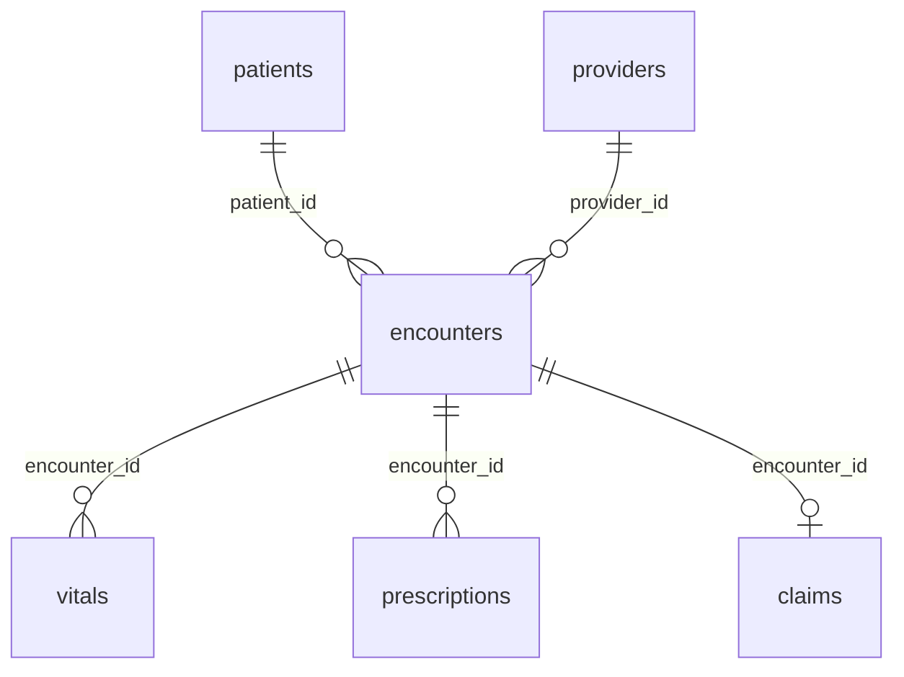

# Synthetic Hospital Records (No Real Patients)

**300K rows: patients, encounters, ICD-10 diagnoses, vitals, prescriptions, claims.**

A regional hospital from 1 January 2025 to 30 September 2026. Thirty thousand fictional patients have 70,000 outpatient, emergency and inpatient encounters with 600 providers. Each encounter carries an ICD-10 diagnosis and a charge, and links to vital-sign readings, prescriptions and an insurance claim. No row describes a real person, so the data can be used and shared without privacy approval.

| | |
|---|---|
| Tables | 6 |
| Rows | 300,000 |
| Full data | [CSV](https://github.com/generaterealdata/synthetic-datasets/releases/download/v1.0/hospital-records-csv.zip) · [SQLite](https://github.com/generaterealdata/synthetic-datasets/releases/download/v1.0/hospital-records-sqlite.zip) · [PostgreSQL script](https://github.com/generaterealdata/synthetic-datasets/releases/download/v1.0/hospital-records-postgresql.zip) · [Kaggle](https://www.kaggle.com/datasets/generaterealdata/synthetic-hospital-records) |
| Sample in this folder | [`sample/`](sample/), a connected slice of up to 1,000 rows per table |
| Licence | [CC BY 4.0](../LICENSE): free to use, share and adapt, with credit |
| Made with | [GenerateRealData](https://generaterealdata.com/industries/healthcare/), fully synthetic, no real records |

## What makes it useful

- Clinical codes are real: 40 common ICD-10 codes, each always paired with its official description, and 25 generic drugs each with one usual dose.
- Stays make sense: discharge date = admit date + length of stay; outpatient visits are same-day, emergency visits 0-1 days, inpatient stays 1-12 days, and charges rise accordingly.
- Everything recorded during an encounter is dated inside it: vitals and prescriptions fall between admission and discharge.
- Claims follow the money: billed amount = the encounter's charge, allowed <= billed, paid <= allowed, and only paid claims carry a payment. Claims for the most recent discharges are still pending.

**Good for:** Healthcare analytics practice without privacy risk; Testing EHR, billing and claims software; SQL practice on a six-table clinical schema; Teaching health data modelling.

## Tables



| Table | Rows | What it holds |
|---|---:|---|
| `patients` | 30,000 | One row per patient. Every patient has at least one encounter. |
| `providers` | 600 | Doctors. |
| `encounters` | 70,000 | One row per visit or stay. |
| `vitals` | 120,000 | Vital-sign readings. Every encounter has at least one. |
| `prescriptions` | 50,000 | Medicines prescribed during encounters. |
| `claims` | 29,400 | Insurance claims: at most one per encounter. |

## Rules you can rely on

32 rules were checked on the full dataset and all 32 hold. Each rule is a query that counts the rows breaking it, and every count is 0. The queries are in [`checks.sql`](checks.sql).

- patients.patient_id is unique
- patients.mrn is unique
- providers.provider_id is unique
- encounters.encounter_id is unique
- claims.encounter_id is unique
- Every encounters.patient_id exists in patients
- Every encounters.provider_id exists in providers
- Every vitals.encounter_id exists in encounters
- Every prescriptions.encounter_id exists in encounters
- Every claims.encounter_id exists in encounters
- Every patient has an encounter
- Every encounter has vitals
- Discharge date = admit date + length of stay
- Length of stay fits the encounter type
- Charges fit the encounter type
- An ICD-10 code always has the same diagnosis text
- There are 40 different diagnoses
- A specialty always sits in the same department
- Patients were born before their first admission
- Vitals are recorded between admission and discharge
- Diastolic is lower than systolic
- Vitals are within human ranges
- A drug always has the same dose
- Prescribed during the encounter
- Billed amount equals the encounter's total charge
- Allowed <= billed and paid <= allowed
- Only paid claims carry a payment
- Claim submitted 1-20 days after discharge
- Decision date is empty exactly while pending, otherwise 5-45 days after submission
- No admission or discharge is dated after 2026-09-30
- No claim is submitted or decided after 2026-09-30
- Claims are pending exactly when the discharge was on or after 2026-07-25

## Column dictionary

The last column is measured from the data.

### `patients` (30,000 rows)

One row per patient. Every patient has at least one encounter.

| Column | Type | Meaning | In this dataset |
|---|---|---|---|
| `patient_id` (PK) | INTEGER | Patient number (primary key). | 1 to 30,000 |
| `mrn` | VARCHAR(12) | Unique medical record number, MRN-0000001 onwards. | 30,000 different values, e.g. `MRN-0000005`, `MRN-0000102` |
| `first_name` | VARCHAR(60) | Given name (fictional). | 689 different values, e.g. `Corey`, `Robert` |
| `last_name` | VARCHAR(60) | Family name (fictional). | 1,000 different values, e.g. `Smith`, `Carter` |
| `sex` | CHAR(1) | F or M. | `F` 52%, `M` 48% |
| `date_of_birth` | DATE | Date of birth; all ages from infants to the over-90s, weighted towards older adults. | 1931-01-01 to 2024-12-28 |
| `blood_type` | VARCHAR(3) | ABO and Rh blood group, in realistic proportions. | `O+` 36.9%, `A+` 36.2%, `B+` 9%, `O-` 7%, `A-` 6%, `AB+` 3%, `B-` 1.4%, `AB-` 0.5% |
| `city` | VARCHAR(80) | Home town: one of twelve invented towns in the hospital's region. | `Ashford` 8.8%, `Milton` 8.6%, `Harmon` 8.5%, `Oakdale` 8.5%, `Fairview` 8.4%, `Clearwater` 8.4%, `Riverton` 8.3%, `Weston` 8.3% and 4 more |
| `insurance_type` | VARCHAR(12) | How the patient is covered. | `private` 55.6%, `public` 37.2%, `self_pay` 7.2% |

### `providers` (600 rows)

Doctors.

| Column | Type | Meaning | In this dataset |
|---|---|---|---|
| `provider_id` (PK) | INTEGER | Provider number (primary key). | 1 to 600 |
| `full_name` | VARCHAR(120) | Full name (fictional). | 597 different values, e.g. `James Carter`, `William Thomas` |
| `specialty` | VARCHAR(40) | Medical specialty. | `Family Medicine` 21%, `Emergency Medicine` 16.8%, `Cardiology` 8.8%, `Pulmonology` 8%, `Endocrinology` 7.5%, `Gastroenterology` 7.3%, `General Surgery` 6.8%, `Orthopaedics` 6.3% and 4 more |
| `department` | VARCHAR(40) | Hospital department; a specialty always sits in the same department. | `Outpatient Clinic` 21%, `Emergency` 16.8%, `Surgery` 16.5%, `Internal Medicine` 14.8%, `Cardiology` 8.8%, `Respiratory` 8%, `Paediatrics` 6.2%, `Behavioural Health` 4% and 1 more |

### `encounters` (70,000 rows)

One row per visit or stay.

| Column | Type | Meaning | In this dataset |
|---|---|---|---|
| `encounter_id` (PK) | INTEGER | Encounter number (primary key). | 1 to 70,000 |
| `patient_id` → `patients.patient_id` | INTEGER | The patient seen. | 1 to 30,000 |
| `provider_id` → `providers.provider_id` | INTEGER | The treating provider. | 1 to 600 |
| `encounter_type` | VARCHAR(12) | outpatient, emergency or inpatient. | `outpatient` 62.1%, `emergency` 24%, `inpatient` 14% |
| `admit_date` | DATE | Date of the visit or admission. | 2025-01-01 to 2026-09-14 |
| `discharge_date` | DATE | admit_date + length_of_stay. | 2025-01-01 to 2026-09-24 |
| `length_of_stay` | INTEGER | Nights in hospital: 0 for outpatient, 0-1 for emergency, 1-12 for inpatient. | `0` 82.5%, `1` 4.9%, `2` 2.9%, `3` 2.8%, `4` 1.4%, `6` 1.3%, `7` 1.3%, `8` 0.7% and 5 more |
| `icd10_code` | VARCHAR(8) | ICD-10 diagnosis code (40 common codes). | 40 different values, e.g. `K80.20`, `M54.50` |
| `diagnosis` | VARCHAR(120) | The official description of icd10_code; always the same text for a code. | 40 different values, e.g. `Calculus of gallbladder without cholecystiti`, `Low back pain, unspecified` |
| `total_charge` | NUMERIC(12,2) | Charge in USD: 80-900 outpatient, 400-6,000 emergency, 4,000-60,000 inpatient. | 80.02 to 59,983.66 |

### `vitals` (120,000 rows)

Vital-sign readings. Every encounter has at least one.

| Column | Type | Meaning | In this dataset |
|---|---|---|---|
| `vital_id` (PK) | INTEGER | Reading number (primary key). | 1 to 120,000 |
| `encounter_id` → `encounters.encounter_id` | INTEGER | The encounter during which the reading was taken. | 1 to 70,000 |
| `recorded_on` | DATE | Date of the reading; between the encounter's admit and discharge dates. | 2025-01-01 to 2026-09-23 |
| `heart_rate` | INTEGER | Beats per minute, 50-130, centred near 78. | 50 to 130 |
| `systolic_bp` | INTEGER | Systolic blood pressure in mmHg, 90-190, centred near 128. | 90 to 190 |
| `diastolic_bp` | INTEGER | Diastolic blood pressure in mmHg; always lower than systolic. | 55 to 115 |
| `temperature_c` | NUMERIC(4,1) | Body temperature in degrees Celsius, centred near 36.9. | 35.5 to 39.2 |
| `spo2` | INTEGER | Oxygen saturation in percent, centred near 97. | `97` 21.9%, `98` 18.9%, `96` 18.7%, `95` 12%, `99` 12%, `100` 8.2%, `94` 5.7%, `93` 2% and 4 more |
| `respiratory_rate` | INTEGER | Breaths per minute, centred near 16. | 10 to 27 |

### `prescriptions` (50,000 rows)

Medicines prescribed during encounters.

| Column | Type | Meaning | In this dataset |
|---|---|---|---|
| `prescription_id` (PK) | INTEGER | Prescription number (primary key). | 1 to 50,000 |
| `encounter_id` → `encounters.encounter_id` | INTEGER | The encounter in which it was prescribed. | 4 to 70,000 |
| `drug_name` | VARCHAR(60) | Generic drug name (25 common drugs). | 25 different values, e.g. `levothyroxine`, `simvastatin` |
| `dose_mg` | NUMERIC(8,2) | Dose in milligrams; a drug always has the same dose. | `500` 16.3%, `20` 15.9%, `50` 12.2%, `10` 11.9%, `40` 8.1%, `250` 7.9%, `5` 7.9%, `25` 4.1% and 4 more |
| `frequency` | VARCHAR(20) | How often it is taken. | `once daily` 48.1%, `twice daily` 29.8%, `three times daily` 11.9%, `as needed` 10.1% |
| `days_supply` | INTEGER | Days of medicine supplied. | `30` 29.8%, `7` 18.2%, `90` 16.1%, `5` 14.3%, `10` 11.7%, `14` 9.9% |
| `prescribed_on` | DATE | Date prescribed; between the encounter's admit and discharge dates. | 2025-01-01 to 2026-09-21 |

### `claims` (29,400 rows)

Insurance claims: at most one per encounter.

| Column | Type | Meaning | In this dataset |
|---|---|---|---|
| `claim_id` (PK) | INTEGER | Claim number (primary key). | 1 to 29,400 |
| `encounter_id` → `encounters.encounter_id` | INTEGER | The encounter claimed for (each appears at most once). | 4 to 69,999 |
| `payer` | VARCHAR(60) | One of eight invented insurers. | `Unity Care` 12.8%, `Bluewater Health Plan` 12.7%, `Northstar Mutual` 12.7%, `CuraHealth` 12.6%, `Evergreen Assurance` 12.4%, `Pioneer Health` 12.4%, `Summit Shield` 12.3%, `State Medical Plan` 12.1% |
| `billed_amount` | NUMERIC(12,2) | Equals the encounter's total_charge. | 80.05 to 59,823.12 |
| `allowed_amount` | NUMERIC(12,2) | What the insurer accepts: 55-95% of billed_amount. | 44.57 to 55,734.43 |
| `paid_amount` | NUMERIC(12,2) | What was paid: 80-100% of allowed_amount when paid, otherwise 0. | 0 to 53,989.52 |
| `status` | VARCHAR(10) | paid, denied, appealed or pending. Pending exactly when the discharge was on or after 25 July 2026. | `paid` 77%, `denied` 9.1%, `pending` 8.4%, `appealed` 5.5% |
| `submitted_on` | DATE | 1-20 days after discharge. | 2025-01-02 to 2026-09-30 |
| `decided_on` | DATE | 5-45 days after submitted_on; empty while pending. | 2025-01-07 to 2026-09-22; 8.4% empty |

## Questions to try

**Encounters, average stay and average charge by type**

```sql
SELECT encounter_type, COUNT(*) AS encounters, ROUND(AVG(length_of_stay), 2) AS avg_stay_days, ROUND(AVG(total_charge), 2) AS avg_charge
FROM encounters GROUP BY encounter_type;
```

**The ten most common diagnoses**

```sql
SELECT icd10_code, diagnosis, COUNT(*) AS encounters
FROM encounters GROUP BY icd10_code, diagnosis ORDER BY encounters DESC LIMIT 10;
```

**Encounters per patient by age group**

```sql
SELECT CASE WHEN age < 18 THEN '0-17' WHEN age < 40 THEN '18-39' WHEN age < 65 THEN '40-64' ELSE '65+' END AS age_group,
       COUNT(DISTINCT patient_id) AS patients, COUNT(*) AS encounters,
       ROUND(1.0 * COUNT(*) / COUNT(DISTINCT patient_id), 2) AS encounters_per_patient
FROM (SELECT e.patient_id, (julianday(e.admit_date) - julianday(p.date_of_birth)) / 365.25 AS age
      FROM encounters e JOIN patients p USING (patient_id))
GROUP BY age_group ORDER BY MIN(age);
```

Seven more are in [`questions.sql`](questions.sql). All ten run as written on the SQLite file.

## Good to know

- Not for clinical research: diagnoses, vitals and prescriptions are assigned independently, so a drug does not follow from the diagnosis and vitals do not reflect the illness.
- A provider's specialty is not matched to the diagnoses they see.
- Dates are whole days; there are no times of day.
- Names are English-style, and the twelve towns are invented.
- Yes/no columns hold 1 and 0. Empty cells in the CSV files mean no value (NULL in the database files).
- The CSV files are UTF-8. Dates are `YYYY-MM-DD` and timestamps `YYYY-MM-DD HH:MM:SS`.

## Files

| File | What it is |
|---|---|
| `schema.sql` | The `CREATE TABLE` statements (PostgreSQL syntax) the data was generated from |
| `generation.json` | Settings of the run: seed, rows per table, options |
| `plan.json` | The full generation plan: one rule set per column |
| `checks.sql` | One query per rule above; each returns 0 on the full dataset |
| `questions.sql` | Ten practice questions with their queries |
| `sample/` | `patients.csv` 251 rows; `providers.csv` 343 rows; `encounters.csv` 589 rows; `vitals.csv` 1,000 rows; `prescriptions.csv` 432 rows; `claims.csv` 259 rows |

## Re-create it

The dataset is reproducible. With a GenerateRealData API key, [`scripts/recreate.py`](../scripts/recreate.py) sends `plan.json`, `schema.sql` and the seed `20261105` to the API and downloads the same data:

```bash
python scripts/recreate.py hospital-records
```

To build your own version, change the row counts or rules, or start from your own schema: [generaterealdata.com/industries/healthcare/](https://generaterealdata.com/industries/healthcare/).

## How it was made

Fully synthetic: generated with [GenerateRealData](https://generaterealdata.com/industries/healthcare/) from a database schema and a set of rules, using a fixed seed. No real person, company or transaction is in the data, and no value was edited after generation. No field was written by AI. 

## Licence

[CC BY 4.0](https://creativecommons.org/licenses/by/4.0/). Use it for anything, including commercial work; please credit "Synthetic Hospital Records (No Real Patients), GenerateRealData" with a link to https://generaterealdata.com.
