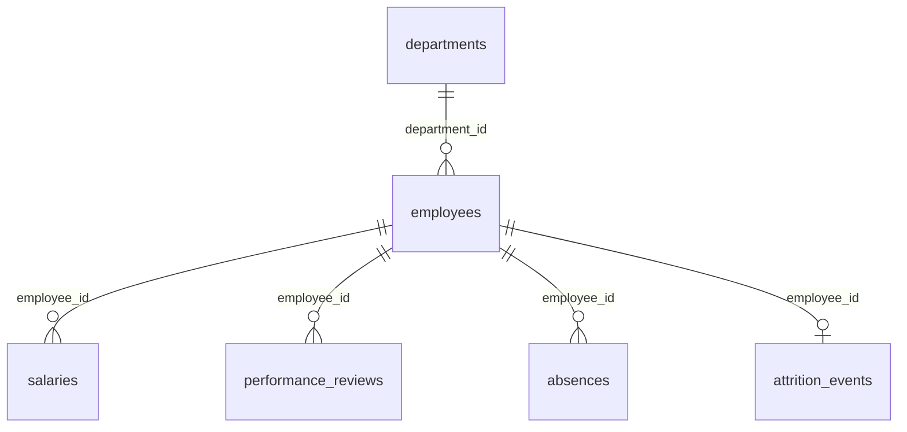

# Synthetic HR, Workforce and Attrition

**150K rows: employees, salaries, reviews, absences and who left, in 6 tables.**

A company of 20,000 current and former employees in 40 departments across eight offices, hired between 2015 and August 2026. Six tables hold the organisation, each person's job and level, salary records, performance reviews, absences and one attrition event for everyone who left. All people are fictional.

| | |
|---|---|
| Tables | 6 |
| Rows | 149,798 |
| Full data | [CSV](https://github.com/generaterealdata/synthetic-datasets/releases/download/v1.0/hr-workforce-attrition-csv.zip) · [SQLite](https://github.com/generaterealdata/synthetic-datasets/releases/download/v1.0/hr-workforce-attrition-sqlite.zip) · [PostgreSQL script](https://github.com/generaterealdata/synthetic-datasets/releases/download/v1.0/hr-workforce-attrition-postgresql.zip) · [Kaggle](https://www.kaggle.com/datasets/generaterealdata/synthetic-hr-workforce-attrition) |
| Sample in this folder | [`sample/`](sample/), a connected slice of up to 1,000 rows per table |
| Licence | [CC BY 4.0](../LICENSE): free to use, share and adapt, with credit |
| Made with | [GenerateRealData](https://generaterealdata.com/industries/hr-recruiting/), fully synthetic, no real records |

## What makes it useful

- A realistic pyramid: seven job levels with far fewer people at the top, job titles that follow the level and name the department, and salary bands that rise with the level.
- Leaving is consistent across tables: every terminated employee has a termination date and exactly one attrition event on that date; nobody else has either.
- Reviews hang together: goals met follows the rating, and promotion is recommended only for ratings 4 and 5.
- Dates respect employment: salaries, reviews and absences never start before the hire date, and an absence's end date = start date + days - 1.

**Good for:** People-analytics dashboards: headcount, turnover, pay bands, absence; SQL practice with dates and multi-table joins; Testing HR and payroll systems; Teaching attrition analysis.

## Tables



| Table | Rows | What it holds |
|---|---:|---|
| `departments` | 40 | The 40 departments. |
| `employees` | 20,000 | One row per current or former employee. |
| `salaries` | 45,000 | Salary records. Every employee has at least one. |
| `performance_reviews` | 60,000 | Performance reviews. Every employee has at least one. |
| `absences` | 21,760 | Periods of absence. |
| `attrition_events` | 2,998 | One row for each employee who left. |

## Rules you can rely on

28 rules were checked on the full dataset and all 28 hold. Each rule is a query that counts the rows breaking it, and every count is 0. The queries are in [`checks.sql`](checks.sql).

- departments.department_id is unique
- employees.employee_id is unique
- employees.email is unique
- Every employees.department_id exists in departments
- Every salaries.employee_id exists in employees
- Every performance_reviews.employee_id exists in employees
- Every absences.employee_id exists in employees
- Every attrition_events.employee_id exists in employees
- There are exactly forty departments
- Termination date is set exactly for terminated employees
- Termination is after hire and by 2026-09-30
- Hired at age 21-64
- Every employee has a salary
- Salary starts on or after the hire date
- Base salary fits the job level
- A review is never dated before the hire date
- Job title starts with the level's title and names the department
- Goals met follows the rating
- Promotion is recommended only for ratings 4 and 5
- Absence end = start + days - 1
- Absence starts on or after the hire date
- Every terminated employee has exactly one attrition event
- Attrition events exist only for terminated employees
- left_on equals the termination date
- Performance and redundancy exits are involuntary, others voluntary
- No salary record starts after 2026-09-30
- No review is dated after 2026-09-30
- No absence starts after 2026-09-30

## Column dictionary

The last column is measured from the data.

### `departments` (40 rows)

The 40 departments.

| Column | Type | Meaning | In this dataset |
|---|---|---|---|
| `department_id` (PK) | INTEGER | Department number (primary key). | 1 to 40 |
| `department_name` | VARCHAR(60) | Unique department name. | 40 different values, e.g. `Infrastructure` |
| `division` | VARCHAR(40) | One of eight divisions. | `Technology` 20%, `Sales` 15%, `Operations` 15%, `Marketing` 12.5%, `Finance` 12.5%, `Product` 10%, `People` 10%, `Legal` 5% |
| `location` | VARCHAR(60) | Office city. | `Toronto` 12.5%, `Sydney` 12.5%, `New York` 12.5%, `London` 12.5%, `Dublin` 12.5%, `Chicago` 12.5%, `Bengaluru` 12.5%, `Austin` 12.5% |

### `employees` (20,000 rows)

One row per current or former employee.

| Column | Type | Meaning | In this dataset |
|---|---|---|---|
| `employee_id` (PK) | INTEGER | Employee number (primary key). | 1 to 20,000 |
| `first_name` | VARCHAR(60) | Given name (fictional). | 686 different values, e.g. `Ian`, `Kristin` |
| `last_name` | VARCHAR(60) | Family name (fictional). | 1,000 different values, e.g. `Woodward`, `Murillo` |
| `email` | VARCHAR(160) | Unique work email built from the name and employee number, at corp.example.com. | 20,000 different values, e.g. `adam.ortega1654@corp.example.com`, `alejandra.myers7959@corp.example.com` |
| `department_id` → `departments.department_id` | INTEGER | The employee's department. | 1 to 40 |
| `job_title` | VARCHAR(80) | Level title plus department, e.g. 'Lead, People Operations'. | 280 different values, e.g. `Lead, People Operations`, `Associate, Financial Planning` |
| `job_level` | INTEGER | 1 (Associate) to 7 (Vice President). | `1` 30%, `2` 26.2%, `3` 20.3%, `4` 12.1%, `5` 7.5%, `6` 2.9%, `7` 1% |
| `hire_date` | DATE | First day at the company. | 2015-01-01 to 2026-08-30 |
| `termination_date` | DATE | Last day; set only for terminated employees, always after hire_date and never after 30 September 2026. | 2015-04-20 to 2026-09-30; 85% empty |
| `employment_status` | VARCHAR(12) | active, on_leave or terminated. | `active` 82.2%, `terminated` 15%, `on_leave` 2.8% |
| `gender` | VARCHAR(12) | Female, Male or Non-binary. | `Male` 49.7%, `Female` 47.2%, `Non-binary` 3.1% |
| `date_of_birth` | DATE | Date of birth; everyone was 21-64 when hired. | 1951-06-06 to 2005-05-04 |
| `work_mode` | VARCHAR(8) | office, hybrid or remote. | `hybrid` 48%, `office` 29.9%, `remote` 22.1% |

### `salaries` (45,000 rows)

Salary records. Every employee has at least one.

| Column | Type | Meaning | In this dataset |
|---|---|---|---|
| `salary_id` (PK) | INTEGER | Salary record number (primary key). | 1 to 45,000 |
| `employee_id` → `employees.employee_id` | INTEGER | The employee paid. | 1 to 20,000 |
| `effective_from` | DATE | Date the salary applies from; never before the hire date. | 2015-01-29 to 2026-09-29 |
| `base_salary` | NUMERIC(12,2) | Yearly base salary in USD, within the band of the employee's job level. | 38,000.93 to 419,162.07 |
| `bonus_pct` | NUMERIC(4,1) | Target bonus as a percentage of base: 0-10 for levels 1-3, 10-40 for levels 4-7. | 0 to 40 |
| `currency` | CHAR(3) | Always USD. | `USD` 100% |

### `performance_reviews` (60,000 rows)

Performance reviews. Every employee has at least one.

| Column | Type | Meaning | In this dataset |
|---|---|---|---|
| `review_id` (PK) | INTEGER | Review number (primary key). | 1 to 60,000 |
| `employee_id` → `employees.employee_id` | INTEGER | The employee reviewed. | 1 to 20,000 |
| `review_date` | DATE | Date of the review; never before the hire date. | 2016-01-01 to 2026-09-29 |
| `rating` | INTEGER | 1 (poor) to 5 (outstanding), centred on 3. | `3` 46.2%, `4` 28%, `2` 13.9%, `5` 8%, `1` 3.9% |
| `goals_met_pct` | INTEGER | Share of goals met, in percent; higher for higher ratings. | 20 to 100 |
| `promotion_recommended` | BOOLEAN | 1 if promotion was recommended; only possible for ratings 4 and 5. | `0` 88.3%, `1` 11.7% |

### `absences` (21,760 rows)

Periods of absence.

| Column | Type | Meaning | In this dataset |
|---|---|---|---|
| `absence_id` (PK) | INTEGER | Absence number (primary key). | 1 to 21,760 |
| `employee_id` → `employees.employee_id` | INTEGER | The absent employee. | 7 to 20,000 |
| `start_date` | DATE | First day absent; never before the hire date. | 2015-02-06 to 2026-09-28 |
| `end_date` | DATE | Last day absent = start_date + days - 1. | 2015-02-07 to 2026-12-25 |
| `absence_type` | VARCHAR(12) | vacation, sick, training, parental or unpaid. | `vacation` 58.5%, `sick` 26.3%, `training` 8%, `parental` 4.1%, `unpaid` 3.1% |
| `days` | INTEGER | Length in days; the range depends on the type (parental leave is 30-120 days). | 1 to 120 |

### `attrition_events` (2,998 rows)

One row for each employee who left.

| Column | Type | Meaning | In this dataset |
|---|---|---|---|
| `attrition_id` (PK) | INTEGER | Attrition event number (primary key). | 1 to 2,998 |
| `employee_id` → `employees.employee_id` | INTEGER | The employee who left (each appears once). | 8 to 19,982 |
| `left_on` | DATE | Equals the employee's termination_date. | 2015-04-20 to 2026-09-30 |
| `reason` | VARCHAR(20) | Main reason for leaving. | `better_offer` 34.5%, `career_change` 16%, `performance` 12.8%, `personal` 11.9%, `relocation` 11.3%, `redundancy` 8.5%, `retirement` 5% |
| `voluntary` | BOOLEAN | 0 for performance and redundancy exits, 1 for all others. | `1` 78.7%, `0` 21.3% |
| `exit_interview_score` | INTEGER | Exit interview score, 1-10; empty when no interview took place. | `3` 10.4%, `8` 9.7%, `6` 9.6%, `7` 9.5%, `9` 9.1%, `2` 8.7%, `4` 7.8%, `5` 7.3% and 2 more; 19.4% empty |

## Questions to try

**Headcount and attrition rate by division**

```sql
SELECT d.division, COUNT(*) AS employees, SUM(e.employment_status = 'terminated') AS left_company,
       ROUND(100.0 * SUM(e.employment_status = 'terminated') / COUNT(*), 1) AS attrition_pct
FROM employees e JOIN departments d USING (department_id) GROUP BY d.division ORDER BY employees DESC;
```

**The job pyramid: people and average latest salary per level**

```sql
SELECT e.job_level, COUNT(DISTINCT e.employee_id) AS employees, ROUND(AVG(s.base_salary), 0) AS avg_base_salary
FROM employees e JOIN salaries s USING (employee_id)
WHERE s.effective_from = (SELECT MAX(effective_from) FROM salaries x WHERE x.employee_id = e.employee_id)
GROUP BY e.job_level ORDER BY e.job_level;
```

**Why do people leave?**

```sql
SELECT reason, COUNT(*) AS leavers, ROUND(100.0 * AVG(voluntary), 0) AS voluntary_pct, ROUND(AVG(exit_interview_score), 2) AS avg_exit_score
FROM attrition_events GROUP BY reason ORDER BY leavers DESC;
```

Seven more are in [`questions.sql`](questions.sql). All ten run as written on the SQLite file.

## Good to know

- Attrition is not driven by performance, level or tenure, so a model will find no real signal in them; the dataset suits reporting and SQL more than prediction.
- An employee's salary records are drawn independently within the level's band; they are not a sequence of raises.
- Reviews, absences and salary records can be dated after a terminated employee's last day.
- Names are English-style for every office.
- Yes/no columns hold 1 and 0. Empty cells in the CSV files mean no value (NULL in the database files).
- The CSV files are UTF-8. Dates are `YYYY-MM-DD` and timestamps `YYYY-MM-DD HH:MM:SS`.

## Files

| File | What it is |
|---|---|
| `schema.sql` | The `CREATE TABLE` statements (PostgreSQL syntax) the data was generated from |
| `generation.json` | Settings of the run: seed, rows per table, options |
| `plan.json` | The full generation plan: one rule set per column |
| `checks.sql` | One query per rule above; each returns 0 on the full dataset |
| `questions.sql` | Ten practice questions with their queries |
| `sample/` | `departments.csv` 40 rows; `employees.csv` 323 rows; `salaries.csv` 705 rows; `performance_reviews.csv` 999 rows; `absences.csv` 350 rows; `attrition_events.csv` 54 rows |

## Re-create it

The dataset is reproducible. With a GenerateRealData API key, [`scripts/recreate.py`](../scripts/recreate.py) sends `plan.json`, `schema.sql` and the seed `20261109` to the API and downloads the same data:

```bash
python scripts/recreate.py hr-workforce-attrition
```

To build your own version, change the row counts or rules, or start from your own schema: [generaterealdata.com/industries/hr-recruiting/](https://generaterealdata.com/industries/hr-recruiting/).

## How it was made

Fully synthetic: generated with [GenerateRealData](https://generaterealdata.com/industries/hr-recruiting/) from a database schema and a set of rules, using a fixed seed. No real person, company or transaction is in the data, and no value was edited after generation. No field was written by AI. 

## Licence

[CC BY 4.0](https://creativecommons.org/licenses/by/4.0/). Use it for anything, including commercial work; please credit "Synthetic HR, Workforce and Attrition, GenerateRealData" with a link to https://generaterealdata.com.
