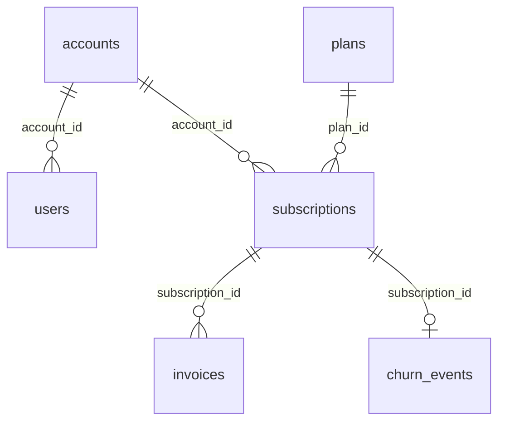

# Synthetic SaaS Subscriptions and Churn

**250K rows: plans, accounts, users, subscriptions, invoices and churn events.**

A business-software company from January 2023 to 30 September 2026. Companies sign up, pick one of eight plans, buy seats, get invoiced and sometimes cancel. Six tables cover the full subscription business: the price list, customer accounts and their users, subscriptions with monthly recurring revenue, invoices and churn events.

| | |
|---|---|
| Tables | 6 |
| Rows | 249,113 |
| Full data | [Kaggle](https://www.kaggle.com/datasets/generaterealdata/synthetic-saas-subscriptions-churn): CSV files and a SQLite database |
| Sample in this folder | [`sample/`](sample/), a connected slice of up to 1,000 rows per table |
| Licence | [CC BY 4.0](../LICENSE): free to use, share and adapt, with credit |
| Made with | [GenerateRealData](https://generaterealdata.com/use-cases/test-data-from-sql-schema/?ref=github), fully synthetic, no real records |

## What makes it useful

- Revenue is exact: a subscription's MRR is seats x the plan's price per seat, and every invoice bills that MRR.
- Churn is consistent: every cancelled subscription has an end date and exactly one churn event on that date, and no other subscription has one.
- Seat counts follow company size, billing cycle matches the plan (Monthly or Annual), and paid invoices are paid in full within 20 days.
- Ready for the classic SaaS metrics from the subscriptions table: MRR, revenue per account, logo churn, revenue churn and cohort retention.

**Good for:** SaaS metrics dashboards (MRR, churn, cohorts); Churn analysis and prediction; Testing billing and subscription systems; SQL practice with dates, cohorts and window functions.

## Tables



| Table | Rows | What it holds |
|---|---:|---|
| `plans` | 8 | The price list: eight plans, four tiers each sold monthly or annually. |
| `accounts` | 12,000 | Customer companies. |
| `users` | 60,000 | People with a login. Every account has at least one. |
| `subscriptions` | 15,000 | Subscriptions. Every account has at least one; some have an earlier one too. |
| `invoices` | 159,792 | Invoices for subscriptions. Every subscription has at least one. |
| `churn_events` | 2,313 | One row for each cancelled subscription. |

## Rules you can rely on

31 rules were checked on the full dataset and all 31 hold. Each rule is a query that counts the rows breaking it, and every count is 0. The queries are in [`checks.sql`](checks.sql).

- plans.plan_id is unique
- accounts.account_id is unique
- users.email is unique
- subscriptions.subscription_id is unique
- invoices.invoice_id is unique
- Every users.account_id exists in accounts
- Every subscriptions.account_id exists in accounts
- Every subscriptions.plan_id exists in plans
- Every invoices.subscription_id exists in subscriptions
- Every churn_events.subscription_id exists in subscriptions
- There are exactly eight plans
- Every account has a subscription
- Subscription starts on or after the account's signup
- Billing cycle matches the plan name
- Mrr = seats x the plan's monthly price
- ended_on is set exactly for cancelled subscriptions
- A subscription ends after it starts and by 2026-09-30
- Every cancelled subscription has exactly one churn event
- Churn events exist only for cancelled subscriptions
- churned_on equals the subscription's ended_on
- Invoice amount_due equals the subscription's mrr
- Invoice period starts on or after the subscription start
- Paid invoices are paid in full, others not at all
- paid_on is set exactly for paid invoices, 0-20 days after issue
- User created on or after the account's signup
- Last login is after creation
- No subscription starts after 2026-09-30
- No invoice period starts after 2026-09-30
- No user was created or logged in after 2026-09-30
- Seats are between 1 and 500
- No single day has more than 1% of all cancellations

## Column dictionary

The last column is measured from the data.

### `plans` (8 rows)

The price list: eight plans, four tiers each sold monthly or annually.

| Column | Type | Meaning | In this dataset |
|---|---|---|---|
| `plan_id` (PK) | INTEGER | Plan number (primary key). | 1 to 8 |
| `plan_name` | VARCHAR(30) | Plan name, e.g. 'Team Annual'. | `Business Annual` 12.5%, `Business Monthly` 12.5%, `Enterprise Annual` 12.5%, `Enterprise Monthly` 12.5%, `Starter Annual` 12.5%, `Starter Monthly` 12.5%, `Team Annual` 12.5%, `Team Monthly` 12.5% |
| `tier` | VARCHAR(12) | Product tier. | `team` 25%, `starter` 25%, `enterprise` 25%, `business` 25% |
| `monthly_price` | NUMERIC(8,2) | Price per seat per month in USD (annual plans are cheaper per month). | `109` 12.5%, `89` 12.5%, `69` 12.5%, `57` 12.5%, `39` 12.5%, `32` 12.5%, `19` 12.5%, `15` 12.5% |
| `seats_included` | INTEGER | Seats included in the plan's base package. | `100` 25%, `25` 25%, `10` 25%, `3` 25% |

### `accounts` (12,000 rows)

Customer companies.

| Column | Type | Meaning | In this dataset |
|---|---|---|---|
| `account_id` (PK) | INTEGER | Account number (primary key). | 1 to 12,000 |
| `company_name` | VARCHAR(120) | Company name (invented). | 10,239 different values, e.g. `Hendrix-Kidd`, `Alexander and Sons` |
| `industry` | VARCHAR(40) | Industry sector. | `Telecommunications` 8.7%, `Media` 8.6%, `Finance` 8.6%, `Education` 8.5%, `Healthcare` 8.4%, `Technology` 8.3%, `Real Estate` 8.3%, `Manufacturing` 8.3% and 4 more |
| `country` | VARCHAR(60) | Country of the company. | `United States` 37.5%, `United Kingdom` 11.9%, `Germany` 9.3%, `Canada` 8.8%, `France` 7%, `Australia` 6%, `Spain` 4.2%, `Netherlands` 3.9% and 4 more |
| `employee_band` | VARCHAR(10) | Company size. | `1-10` 34.4%, `11-50` 32.6%, `51-200` 19.8%, `201-1000` 10%, `1000+` 3.3% |
| `signup_date` | DATE | Date the company signed up. | 2023-01-01 to 2026-09-14 |
| `acquisition_channel` | VARCHAR(16) | How the company found the product. | `organic` 29.9%, `paid_search` 20.3%, `referral` 15.4%, `outbound` 14.6%, `event` 10.1%, `partner` 9.8% |

### `users` (60,000 rows)

People with a login. Every account has at least one.

| Column | Type | Meaning | In this dataset |
|---|---|---|---|
| `user_id` (PK) | INTEGER | User number (primary key). | 1 to 60,000 |
| `account_id` → `accounts.account_id` | INTEGER | The company the user belongs to. | 1 to 12,000 |
| `email` | VARCHAR(160) | Unique login email at an example domain. | 60,000 different values, e.g. `abaker@example.net`, `adamlambert@example.org` |
| `role` | VARCHAR(8) | Permission level. | `member` 72.2%, `admin` 14.9%, `viewer` 9%, `owner` 3.9% |
| `created_at` | TIMESTAMP | When the user was created; never before the account's signup_date. | 2023-01-09 07:12:18 to 2026-09-30 23:43:59 |
| `last_login_at` | TIMESTAMP | Most recent login, after created_at; empty for users who never logged in. | 2023-02-06 10:15:11 to 2026-09-30 23:59:17; 7% empty |
| `is_active` | BOOLEAN | Whether the login is enabled (1 = yes). | `1` 88.1%, `0` 11.9% |

### `subscriptions` (15,000 rows)

Subscriptions. Every account has at least one; some have an earlier one too.

| Column | Type | Meaning | In this dataset |
|---|---|---|---|
| `subscription_id` (PK) | INTEGER | Subscription number (primary key). | 1 to 15,000 |
| `account_id` → `accounts.account_id` | INTEGER | The subscribing company. | 1 to 12,000 |
| `plan_id` → `plans.plan_id` | INTEGER | The plan bought. | `4` 13%, `2` 12.7%, `6` 12.6%, `1` 12.5%, `8` 12.5%, `3` 12.4%, `7` 12.2%, `5` 12.2% |
| `seats` | INTEGER | Seats bought; fits the company's employee_band. | 1 to 497 |
| `billing_cycle` | VARCHAR(8) | monthly or annual; matches the plan name. | `annual` 50.8%, `monthly` 49.2% |
| `started_on` | DATE | Start date; on or after the account's signup_date. | 2023-01-21 to 2026-09-29 |
| `ended_on` | DATE | End date; set only for cancelled subscriptions. | 2023-07-03 to 2026-09-30; 84.6% empty |
| `status` | VARCHAR(10) | active, past_due or cancelled. | `active` 80.7%, `cancelled` 15.4%, `past_due` 3.9% |
| `mrr` | NUMERIC(12,2) | Monthly recurring revenue in USD = seats x the plan's monthly_price. | 15 to 54,064 |

### `invoices` (159,792 rows)

Invoices for subscriptions. Every subscription has at least one.

| Column | Type | Meaning | In this dataset |
|---|---|---|---|
| `invoice_id` (PK) | INTEGER | Invoice number (primary key). | 1 to 159,792 |
| `subscription_id` → `subscriptions.subscription_id` | INTEGER | The subscription billed. | 1 to 15,000 |
| `period_start` | DATE | First day of the billed month; on or after the subscription start. | 2023-01-24 to 2026-09-29 |
| `period_end` | DATE | One month after period_start. | 2023-02-24 to 2026-10-29 |
| `amount_due` | NUMERIC(12,2) | Equals the subscription's mrr. | 15 to 54,064 |
| `amount_paid` | NUMERIC(12,2) | amount_due when paid, otherwise 0. | 0 to 54,064 |
| `status` | VARCHAR(10) | paid, open, past_due or void. | `paid` 91%, `open` 4%, `past_due` 3%, `void` 2% |
| `issued_on` | DATE | Issue date; equals period_start. | 2023-01-24 to 2026-09-29 |
| `paid_on` | DATE | Payment date, 0-20 days after issued_on; empty unless paid. | 2023-02-10 to 2026-10-19; 9% empty |

### `churn_events` (2,313 rows)

One row for each cancelled subscription.

| Column | Type | Meaning | In this dataset |
|---|---|---|---|
| `churn_id` (PK) | INTEGER | Churn event number (primary key). | 1 to 2,313 |
| `subscription_id` → `subscriptions.subscription_id` | INTEGER | The subscription that was cancelled (each appears once). | 9 to 14,985 |
| `churned_on` | DATE | Equals the subscription's ended_on. | 2023-07-03 to 2026-09-30 |
| `reason` | VARCHAR(20) | Main reason given for cancelling. | `price` 26.7%, `low_usage` 25%, `switched_tool` 20.5%, `missing_feature` 16.6%, `support` 6.7%, `company_closed` 4.5% |
| `feedback_score` | INTEGER | Exit survey score, 1 (unhappy) to 10 (happy). | `6` 13.9%, `8` 13.4%, `7` 12.7%, `5` 12.3%, `9` 11.8%, `3` 8.7%, `4` 7.6%, `2` 7.6% and 2 more |

## Questions to try

**Current MRR by plan**

```sql
SELECT p.plan_name, COUNT(*) AS active_subscriptions, SUM(s.seats) AS seats, ROUND(SUM(s.mrr), 2) AS mrr
FROM subscriptions s JOIN plans p USING (plan_id)
WHERE s.status <> 'cancelled'
GROUP BY p.plan_name ORDER BY mrr DESC;
```

**Churn rate by tier**

```sql
SELECT p.tier, COUNT(*) AS subscriptions, SUM(s.status = 'cancelled') AS cancelled,
       ROUND(100.0 * SUM(s.status = 'cancelled') / COUNT(*), 1) AS churn_pct
FROM subscriptions s JOIN plans p USING (plan_id) GROUP BY p.tier ORDER BY churn_pct DESC;
```

**Why do customers leave, and how do they feel about it?**

```sql
SELECT reason, COUNT(*) AS churned, ROUND(AVG(feedback_score), 2) AS avg_feedback
FROM churn_events GROUP BY reason ORDER BY churned DESC;
```

Seven more are in [`questions.sql`](questions.sql). All ten run as written on the SQLite file.

## Good to know

- Invoices are dated at random within the subscription's life rather than one per month: a subscription can have two invoices for the same period, and some are dated after a cancelled subscription ended. Use them for collections and payment analysis, not to rebuild revenue month by month.
- Churn does not depend on the plan or the company size, only on how long the subscription has run; the feedback score does depend on the reason.
- User emails are generic example addresses and do not follow the company name.
- Yes/no columns hold 1 and 0. Empty cells in the CSV files mean no value (NULL in the database files).
- The CSV files are UTF-8. Dates are `YYYY-MM-DD` and timestamps `YYYY-MM-DD HH:MM:SS`.

## Files

| File | What it is |
|---|---|
| `schema.sql` | The `CREATE TABLE` statements (PostgreSQL syntax) the data was generated from |
| `generation.json` | Settings of the run: seed, rows per table, options |
| `plan.json` | The full generation plan: one rule set per column |
| `checks.sql` | One query per rule above; each returns 0 on the full dataset |
| `questions.sql` | Ten practice questions with their queries |
| `sample/` | `plans.csv` 8 rows; `accounts.csv` 79 rows; `users.csv` 317 rows; `subscriptions.csv` 89 rows; `invoices.csv` 986 rows; `churn_events.csv` 20 rows |

## Re-create it

The dataset is reproducible. With a GenerateRealData API key, [`scripts/recreate.py`](../scripts/recreate.py) sends `plan.json`, `schema.sql` and the seed `20261104` to the API and downloads the same data:

```bash
python scripts/recreate.py saas-subscriptions
```

To build your own version, change the row counts or rules, or start from your own schema: [generaterealdata.com/use-cases/test-data-from-sql-schema/](https://generaterealdata.com/use-cases/test-data-from-sql-schema/?ref=github).

## How it was made

Fully synthetic: generated with [GenerateRealData](https://generaterealdata.com/use-cases/test-data-from-sql-schema/?ref=github) from a database schema and a set of rules, using a fixed seed. No real person, company or transaction is in the data, and no value was edited after generation. No field was written by AI. 

## Licence

[CC BY 4.0](https://creativecommons.org/licenses/by/4.0/). Use it for anything, including commercial work; please credit "Synthetic SaaS Subscriptions and Churn, GenerateRealData" with a link to https://generaterealdata.com.
