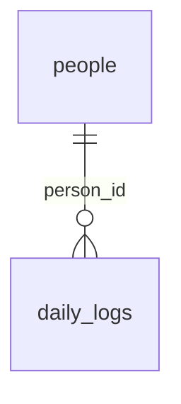

# Screen Time, Sleep and Mental Health

**459K daily logs from 15,300 people: screens, sleep, stress, mood, 30 days each.**

> **Made with [GenerateRealData](https://www.generaterealdata.com?ref=github).** You can create your own realistic datasets like this one in minutes, from a single table to a full database with many linked tables. Just describe what you need in plain English, or upload your SQL schema. IDs match across tables, totals add up, and your business rules hold on every row. With 232 data types and 222 built-in generators, it has one of the largest libraries of any test data generator. **Try it free at [www.generaterealdata.com](https://www.generaterealdata.com?ref=github)**, or write to support@generaterealdata.com.

15,300 people kept a daily log for 30 days, from 3 August to 1 September 2026: 459,000 days in all. Each day records work hours, screen time, social media, screens after 10 pm, caffeine, alcohol, exercise, steps and time outdoors, then when they went to bed, how long and how well they slept, and their stress, mood and productivity. A second table describes the people: age, gender, country, occupation, chronotype (morning or evening type), children, fitness and diagnosed anxiety. The daily table repeats the person's details, so it works on its own.

| | |
|---|---|
| Tables | 2 |
| Rows | 474,300 |
| Full data | [Kaggle](https://www.kaggle.com/datasets/generaterealdata/screen-time-sleep-and-mental-health): CSV files and a SQLite database |
| Sample in this folder | [`sample/`](sample/), a connected slice of up to 1,000 rows per table |
| Licence | [CC BY 4.0](../LICENSE): free to use, share and adapt, with credit |
| Made with | [GenerateRealData](https://www.generaterealdata.com/industries/healthcare/?ref=github), a relational synthetic data generator with 232 data types and 222 built-in generators, one of the largest libraries of any test data generator; fully synthetic, no real records |

## What makes it useful

- Real panel data: the same people every day for 30 days, so you can study habits within a person as well as differences between people.
- Sleep and stress move together: people average stress 3.7 on days with 8 hours of sleep and 5.1 with 6 hours. Weekends bring less work, more screen time, more sleep and stress 2.6 against 5.0 on weekdays.
- Late screens push bedtime back: days with under an hour of screens after 10 pm average 7.7 hours of sleep, days with two hours or more 6.8. Evening types go to bed later and sleep 6.9 hours against 7.8 for morning types.
- A stress level you can learn from the day's habits: work, sleep, social media, exercise, time outdoors, children and anxiety, plus chance. A gradient-boosting model reaches R-squared 0.72 on held-out days.
- Young people look at screens most: 8.0 hours a day under 25, 4.8 hours from 40. 13 rules are checked with SQL and all hold.

**Good for:** Regression: predict stress, mood, sleep or productivity; Panel and time-series analysis of daily habits; Exploratory analysis of screen time and sleep; SQL practice with two tables, joins and window functions; Teaching confounding: weekends, age and occupation change several columns at once.

## Tables



| Table | Rows | What it holds |
|---|---:|---|
| `people` | 15,300 | The 15,300 people who kept a log. |
| `daily_logs` | 459,000 | One row per person per day: 30 days for each person. |

## Rules you can rely on

13 rules were checked on the full dataset and all 13 hold. Each rule is a query that counts the rows breaking it, and every count is 0. The queries are in [`checks.sql`](checks.sql).

- people.person_id is unique
- daily_logs.log_id is unique
- Every daily_logs.person_id exists in people
- Every person has exactly 30 days of logs, one per date
- A person's daily rows carry their own age, gender, occupation, chronotype, children, fitness and anxiety
- day_of_week is the weekday of log_date
- is_weekend exactly on Saturdays and Sundays
- Anyone 22 or younger is a student
- Social media time fits inside screen time
- Bedtime is a clock time 0-24
- Sleep is 3-11 hours
- Scores are 1-10
- Steps are at least 2,500 plus 95 per exercise minute

## Column dictionary

The last column is measured from the data.

### `people` (15,300 rows)

The 15,300 people who kept a log.

| Column | Type | Meaning | In this dataset |
|---|---|---|---|
| `person_id` (PK) | INTEGER | Person number (primary key). | 1 to 15,300 |
| `age` | INTEGER | Age in years, 16-70. | 16 to 70 |
| `gender` | VARCHAR(12) | Female, Male or Non-binary. | `Female` 49.9%, `Male` 48%, `Non-binary` 2.1% |
| `country` | VARCHAR(20) | One of 7 countries: United States, India, United Kingdom, Canada, Germany, Brazil or Australia. | `United States` 34.2%, `India` 22.2%, `United Kingdom` 11.8%, `Canada` 8.8%, `Germany` 7.9%, `Brazil` 7.9%, `Australia` 7.1% |
| `occupation` | VARCHAR(24) | Student (everyone up to 22), Office worker, Software developer, Healthcare worker, Retail worker, Teacher, Self-employed or Unemployed. | `Office worker` 22.9%, `Student` 21.4%, `Software developer` 11.4%, `Retail worker` 10.5%, `Self-employed` 10.1%, `Healthcare worker` 9.8%, `Teacher` 7.5%, `Unemployed` 6.4% |
| `chronotype` | VARCHAR(14) | Morning type, Intermediate or Evening type; evening types are much more common under 25. | `Intermediate` 46.9%, `Evening type` 26.8%, `Morning type` 26.3% |
| `has_children` | BOOLEAN | 1 if the person has children; rare under 25. | `0` 61.4%, `1` 38.6% |
| `fitness_level` | VARCHAR(8) | Low, Medium or High; sets how much the person usually exercises. | `Medium` 44.6%, `Low` 35.4%, `High` 20% |
| `typical_screen_hours` | NUMERIC(4,1) | The person's usual hours of screen time per day; highest for the young. | 2 to 10 |
| `diagnosed_anxiety` | BOOLEAN | 1 if the person has a diagnosed anxiety disorder. | `0` 88%, `1` 12% |

### `daily_logs` (459,000 rows)

One row per person per day: 30 days for each person.

| Column | Type | Meaning | In this dataset |
|---|---|---|---|
| `log_id` (PK) | INTEGER | Log number (primary key). | 1 to 459,000 |
| `person_id` → `people.person_id` | INTEGER | The person who logged the day. | 1 to 15,300 |
| `log_date` | DATE | The day, 2026-08-03 to 2026-09-01. | 2026-08-03 to 2026-09-01 |
| `day_of_week` | VARCHAR(10) | Monday to Sunday. | `Tuesday` 16.7%, `Monday` 16.7%, `Wednesday` 13.3%, `Thursday` 13.3%, `Sunday` 13.3%, `Saturday` 13.3%, `Friday` 13.3% |
| `is_weekend` | BOOLEAN | 1 on Saturday and Sunday. | `0` 73.3%, `1` 26.7% |
| `age` | INTEGER | The person's age (copied from people). | 16 to 70 |
| `gender` | VARCHAR(12) | The person's gender (copied from people). | `Female` 49.9%, `Male` 48%, `Non-binary` 2.1% |
| `occupation` | VARCHAR(24) | The person's occupation (copied from people). | `Office worker` 22.9%, `Student` 21.4%, `Software developer` 11.4%, `Retail worker` 10.5%, `Self-employed` 10.1%, `Healthcare worker` 9.8%, `Teacher` 7.5%, `Unemployed` 6.4% |
| `chronotype` | VARCHAR(14) | The person's chronotype (copied from people). | `Intermediate` 46.9%, `Evening type` 26.8%, `Morning type` 26.3% |
| `has_children` | BOOLEAN | 1 if the person has children (copied from people). | `0` 61.4%, `1` 38.6% |
| `fitness_level` | VARCHAR(8) | The person's fitness level (copied from people). | `Medium` 44.6%, `Low` 35.4%, `High` 20% |
| `diagnosed_anxiety` | BOOLEAN | 1 if the person has diagnosed anxiety (copied from people). | `0` 88%, `1` 12% |
| `work_hours` | NUMERIC(4,1) | Hours worked or studied that day; little on weekends. | 0 to 11.5 |
| `screen_time_hours` | NUMERIC(4,1) | Hours of screen time that day, around the person's typical level; higher on weekends. | 0.3 to 14.3 |
| `social_media_minutes` | INTEGER | Minutes on social media; part of the screen time, more for the young. | 4 to 490 |
| `screen_after_10pm_minutes` | INTEGER | Minutes of screen use after 10 pm; more for evening types. | 0 to 212 |
| `caffeine_mg` | INTEGER | Caffeine taken that day, in milligrams; more for healthcare workers and developers. | 10 to 390 |
| `alcohol_units` | INTEGER | Units of alcohol that day; mostly 0, more on weekends. | `0` 73.3%, `1` 12.8%, `2` 8.1%, `3` 3.6%, `4` 1.3%, `6` 0.8% |
| `exercise_minutes` | INTEGER | Minutes of exercise; set by the fitness level, a little more on weekends. | 0 to 110 |
| `steps` | INTEGER | Steps walked; rises with exercise. | 2,500 to 19,350 |
| `outdoor_minutes` | INTEGER | Minutes spent outdoors; more on weekends. | 5 to 135 |
| `bedtime_hour` | NUMERIC(4,2) | Time the person went to bed, as a decimal hour (23.5 = 23:30, 0.5 = 00:30); later for evening types and after late screens. | 0 to 23.99 |
| `sleep_hours` | NUMERIC(3,1) | Hours slept; less after a late bedtime, late screens, caffeine and alcohol, and with children. | 4.7 to 9.7 |
| `sleep_quality` | INTEGER | Sleep quality, 1-10. | `5` 28.9%, `4` 24.7%, `6` 21.2%, `3` 12%, `7` 8.4%, `2` 3.2%, `8` 1.2%, `1` 0.4% and 1 more |
| `mood_score` | INTEGER | Mood at the end of the day, 1-10; partly built from stress and sleep. | `7` 28.9%, `8` 27.6%, `6` 17.3%, `9` 15.2%, `10` 6.1%, `5` 4.5%, `4` 0.3%, `3` 0% |
| `stress_level` | INTEGER | Stress at the end of the day, 1-10. The column to predict. | `5` 21.9%, `4` 20.9%, `6` 16.9%, `3` 14.9%, `2` 9.3%, `7` 7.6%, `1` 6.1%, `8` 2% and 2 more |
| `productivity_score` | INTEGER | Self-rated productivity, 1-10; partly built from sleep quality and stress. | `5` 32.2%, `6` 25.8%, `4` 24.5%, `7` 8.6%, `3` 7.7%, `2` 0.9%, `8` 0.3%, `1` 0% |

## Questions to try

**Weekdays against weekends: work, screens, sleep and stress**

```sql
SELECT CASE WHEN is_weekend = 1 THEN 'weekend' ELSE 'weekday' END AS day_type, ROUND(AVG(work_hours), 2) AS work_hours,
       ROUND(AVG(screen_time_hours), 2) AS screen_hours, ROUND(AVG(sleep_hours), 2) AS sleep_hours, ROUND(AVG(stress_level), 2) AS stress
FROM daily_logs GROUP BY day_type;
```

**Stress by hours of sleep**

```sql
SELECT CAST(sleep_hours AS INTEGER) AS sleep_hours, COUNT(*) AS days, ROUND(AVG(stress_level), 2) AS avg_stress, ROUND(AVG(mood_score), 2) AS avg_mood
FROM daily_logs GROUP BY 1 ORDER BY 1;
```

**Screens after 10 pm and sleep, in half-hour bands**

```sql
SELECT (screen_after_10pm_minutes / 30) * 30 AS late_screen_from_min, COUNT(*) AS days, ROUND(AVG(sleep_hours), 2) AS sleep_hours,
       ROUND(AVG(sleep_quality), 2) AS sleep_quality
FROM daily_logs GROUP BY 1 ORDER BY 1;
```

Seven more are in [`questions.sql`](questions.sql). All ten run as written on the SQLite file.

## Good to know

- The daily values are built from the person's profile and the day's habits plus chance, so a model learns exactly those links; use the dataset to practise, not as evidence about real people.
- mood_score and productivity_score are built partly from stress and sleep quality: drop them when predicting stress.
- bedtime_hour is a decimal hour of the clock: 22.5 is 22:30 and 0.75 is 00:45 (after midnight, a quarter of all days).
- The 30 days run from a Monday to a Tuesday, so Mondays and Tuesdays appear five times and the other days four.
- A person's typical screen time and country are in people only; habits do not drift over the 30 days.
- Yes/no columns hold 1 and 0. Empty cells in the CSV files mean no value (NULL in the database files).
- The CSV files are UTF-8. Dates are `YYYY-MM-DD` and timestamps `YYYY-MM-DD HH:MM:SS`.

## Files

| File | What it is |
|---|---|
| `schema.sql` | The `CREATE TABLE` statements (PostgreSQL syntax) the data was generated from |
| `generation.json` | Settings of the run: seed, rows per table, options |
| `plan.json` | The full generation plan: one rule set per column |
| `checks.sql` | One query per rule above; each returns 0 on the full dataset |
| `questions.sql` | Ten practice questions with their queries |
| `sample/` | `people.csv` 33 rows; `daily_logs.csv` 990 rows |

## Re-create it

The dataset is reproducible. With a GenerateRealData API key, [`scripts/recreate.py`](../scripts/recreate.py) sends `plan.json`, `schema.sql` and the seed `20261515` to the API and downloads the same data:

```bash
python scripts/recreate.py screen-time-wellbeing
```

To build your own version, change the row counts or rules, or start from your own schema: [www.generaterealdata.com/industries/healthcare/](https://www.generaterealdata.com/industries/healthcare/?ref=github).

## How it was made

Fully synthetic: generated with [GenerateRealData](https://www.generaterealdata.com/industries/healthcare/?ref=github) from a database schema and a set of rules, using a fixed seed. No real person, company or transaction is in the data, and no value was edited after generation. No field was written by AI. 

## Licence

[CC BY 4.0](https://creativecommons.org/licenses/by/4.0/). Use it for anything, including commercial work; please credit "Screen Time, Sleep and Mental Health, GenerateRealData" with a link to https://www.generaterealdata.com.
