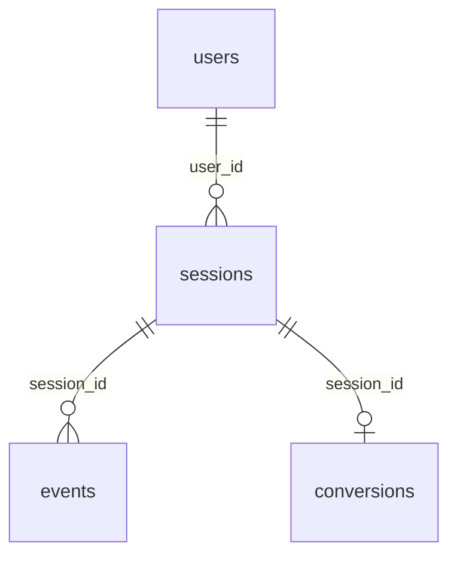

# Synthetic Web Analytics Funnel Events

**Sessions that walk a shop funnel step by step, with real drop-off.**

Website tracking for an online outdoor shop, 1 July to 30 September 2026. Each session is one journey through the funnel: it starts, searches or views products, adds to the cart, begins checkout and either purchases or leaves. Events are ordered within the session, time moves forward, and every purchase has a matching conversion.

| | |
|---|---|
| Tables | 4 |
| Rows | 425,918 |
| Full data | [Kaggle](https://www.kaggle.com/datasets/generaterealdata/synthetic-web-analytics-funnel-events): CSV files and a SQLite database |
| Sample in this folder | [`sample/`](sample/), a connected slice of up to 1,000 rows per table |
| Licence | [CC BY 4.0](../LICENSE): free to use, share and adapt, with credit |
| Made with | [GenerateRealData](https://generaterealdata.com/use-cases/user-behavior-data/), fully synthetic, no real records |

## What makes it useful

- Journeys are valid sequences: every session starts with session_start, only allowed moves occur, and nothing happens after purchase or exit.
- Step numbers run 1, 2, 3 without gaps and timestamps increase with them; the first event is at the session's start time.
- The cart value is 0 until something is added and then stays the same for the rest of the session; the conversion's order value equals it.
- Session duration is the sum of the seconds spent on its steps, and conversions exist only for sessions that purchased.

**Good for:** Funnel and conversion-rate analysis; Sessionisation and path analysis with window functions; Testing product-analytics pipelines and dashboards; A/B-test and attribution exercises.

## Tables



| Table | Rows | What it holds |
|---|---:|---|
| `users` | 30,000 | Known visitors. |
| `sessions` | 84,000 | One row per visit. |
| `events` | 304,309 | One row per step of a session, up to seven steps. |
| `conversions` | 7,609 | One row per purchase. |

## Rules you can rely on

23 rules were checked on the full dataset and all 23 hold. Each rule is a query that counts the rows breaking it, and every count is 0. The queries are in [`checks.sql`](checks.sql).

- users.user_id is unique
- sessions.session_id is unique
- events.event_id is unique
- conversions.session_id is unique
- Every sessions.user_id exists in users
- Every events.session_id exists in sessions
- Every conversions.session_id exists in sessions
- Session never starts before the user signed up
- Every journey starts with session_start
- Step numbers run 1, 2, 3 with no gaps
- Time moves forward within a session
- Nothing happens after purchase or exit
- Only allowed funnel moves occur
- Cart is empty before add_to_cart
- Purchase and checkout carry a cart value
- The cart value stays the same within a session once something is added
- Session duration = sum of its steps' seconds
- The first event happens at the session start
- Every purchase has exactly one conversion
- Conversions exist only for sessions that purchased
- Conversion value equals the purchase's cart value
- Every session has events
- No session starts after 2026-09-30

## Column dictionary

The last column is measured from the data.

### `users` (30,000 rows)

Known visitors.

| Column | Type | Meaning | In this dataset |
|---|---|---|---|
| `user_id` (PK) | INTEGER | User number (primary key). | 1 to 30,000 |
| `signup_date` | DATE | Date the visitor registered. | 2024-01-01 to 2026-06-29 |
| `country` | VARCHAR(60) | Country of the visitor. | `United States` 37.8%, `United Kingdom` 12%, `Germany` 9.1%, `Canada` 8.9%, `France` 7.2%, `Australia` 6%, `Spain` 4.1%, `Italy` 3.8% and 4 more |
| `device_preference` | VARCHAR(8) | The device the visitor usually uses. | `mobile` 58.1%, `desktop` 33.8%, `tablet` 8.1% |
| `acquisition_channel` | VARCHAR(14) | How the visitor first arrived. | `organic` 31.9%, `paid_search` 22%, `social` 18%, `direct` 14.2%, `email` 8.9%, `referral` 5% |
| `is_customer` | BOOLEAN | Whether the visitor has bought before (1 = yes). | `0` 76.5%, `1` 23.4% |

### `sessions` (84,000 rows)

One row per visit.

| Column | Type | Meaning | In this dataset |
|---|---|---|---|
| `session_id` (PK) | INTEGER | Session number (primary key). | 1 to 84,000 |
| `user_id` → `users.user_id` | INTEGER | The visitor. A few visitors have many sessions. | 1 to 30,000 |
| `started_at` | TIMESTAMP | When the session began. | 2026-07-01 00:00:53 to 2026-09-29 23:59:57 |
| `device` | VARCHAR(8) | Device used in this session. | `mobile` 58.2%, `desktop` 34%, `tablet` 7.9% |
| `browser` | VARCHAR(20) | Browser used. | `Chrome` 52.3%, `Safari` 29.8%, `Edge` 8%, `Firefox` 6.9%, `Samsung Internet` 3% |
| `referrer` | VARCHAR(40) | Where the visit came from. | `google` 38.3%, `direct` 23.8%, `instagram` 11.1%, `facebook` 9%, `newsletter` 7.9%, `partner site` 5.1%, `bing` 4.9% |
| `landing_page` | VARCHAR(120) | First page of the visit. | `/` 34.3%, `/sale` 15.9%, `/category/tents` 10%, `/category/footwear` 10%, `/p/trail-runner-x` 8.9%, `/blog/packing-list` 8%, `/p/alpine-2-person-tent` 7%, `/category/apparel` 5.9% |
| `duration_s` | INTEGER | Session length in seconds = the sum of secs_on_step over its events. | 6 to 1,113 |

### `events` (304,309 rows)

One row per step of a session, up to seven steps.

| Column | Type | Meaning | In this dataset |
|---|---|---|---|
| `event_id` (PK) | INTEGER | Event number (primary key). | 1 to 304,309 |
| `session_id` → `sessions.session_id` | INTEGER | The session the event belongs to. | 1 to 84,000 |
| `step_no` | INTEGER | Position in the session: 1, 2, 3 ... without gaps. | `2` 27.6%, `1` 27.6%, `3` 20.6%, `4` 12.4%, `5` 7.4%, `6` 3.2%, `7` 1.1% |
| `event_name` | VARCHAR(16) | The funnel step: session_start, search, view_product, add_to_cart, begin_checkout, purchase or exit. | `session_start` 27.6%, `view_product` 26.3%, `exit` 24.7%, `add_to_cart` 7.9%, `search` 6.9%, `begin_checkout` 4.2%, `purchase` 2.5% |
| `page_path` | VARCHAR(120) | Page for the step: the landing page, a search URL, a product page, /cart, /checkout, /checkout/thank-you, or '(left site)' for exit. | 30 different values, e.g. `/checkout`, `/sale` |
| `occurred_at` | TIMESTAMP | When the step happened; increases with step_no. | 2026-07-01 00:00:53 to 2026-09-30 00:02:28 |
| `secs_on_step` | INTEGER | Seconds spent on the step. | 3 to 240 |
| `cart_value` | NUMERIC(10,2) | Value of the cart in USD: 0 before add_to_cart, then constant within the session. | 0 to 599.95 |

### `conversions` (7,609 rows)

One row per purchase.

| Column | Type | Meaning | In this dataset |
|---|---|---|---|
| `conversion_id` (PK) | INTEGER | Conversion number (primary key). | 1 to 7,609 |
| `session_id` → `sessions.session_id` | INTEGER | The session that purchased (each appears once). | 13 to 83,994 |
| `order_value` | NUMERIC(10,2) | Equals the cart value of the purchase event. | 15.04 to 599.88 |
| `items` | INTEGER | Number of items bought. | `1` 47.2%, `2` 29.3%, `3` 13%, `4` 5.8%, `5` 3.2%, `6` 1.6% |
| `coupon_code` | VARCHAR(16) | Coupon used; empty for most orders. | `FREESHIP` 5.1%, `SUMMER15` 5%, `WELCOME10` 5%, `VIP20` 4.8%; 80.1% empty |
| `converted_at` | TIMESTAMP | Equals the time of the purchase event. | 2026-07-01 00:15:56 to 2026-09-29 23:53:16 |

## Questions to try

**The funnel: how many sessions reach each step?**

```sql
SELECT event_name, COUNT(DISTINCT session_id) AS sessions,
       ROUND(100.0 * COUNT(DISTINCT session_id) / (SELECT COUNT(DISTINCT session_id) FROM events), 1) AS pct_of_sessions
FROM events WHERE event_name <> 'exit'
GROUP BY event_name ORDER BY sessions DESC;
```

**Conversion rate by device**

```sql
SELECT s.device, COUNT(*) AS sessions, COUNT(c.conversion_id) AS purchases,
       ROUND(100.0 * COUNT(c.conversion_id) / COUNT(*), 2) AS conversion_pct
FROM sessions s LEFT JOIN conversions c USING (session_id) GROUP BY s.device;
```

**Revenue and average order value by referrer**

```sql
SELECT s.referrer, COUNT(*) AS orders, ROUND(SUM(c.order_value), 2) AS revenue, ROUND(AVG(c.order_value), 2) AS avg_order_value
FROM conversions c JOIN sessions s USING (session_id) GROUP BY s.referrer ORDER BY revenue DESC;
```

Seven more are in [`questions.sql`](questions.sql). All ten run as written on the SQLite file.

## Good to know

- Drop-off at each step is the same for every device, channel and user, so segment differences are noise.
- The gap between events and secs_on_step are generated separately, so they do not match exactly.
- A session's cart value is fixed for the whole session; adding more products does not change it.
- Users have no names or emails by design.
- Yes/no columns hold 1 and 0. Empty cells in the CSV files mean no value (NULL in the database files).
- The CSV files are UTF-8. Dates are `YYYY-MM-DD` and timestamps `YYYY-MM-DD HH:MM:SS`.

## Files

| File | What it is |
|---|---|
| `schema.sql` | The `CREATE TABLE` statements (PostgreSQL syntax) the data was generated from |
| `generation.json` | Settings of the run: seed, rows per table, options |
| `plan.json` | The full generation plan: one rule set per column |
| `checks.sql` | One query per rule above; each returns 0 on the full dataset |
| `questions.sql` | Ten practice questions with their queries |
| `sample/` | `users.csv` 114 rows; `sessions.csv` 266 rows; `events.csv` 997 rows; `conversions.csv` 26 rows |

## Re-create it

The dataset is reproducible. With a GenerateRealData API key, [`scripts/recreate.py`](../scripts/recreate.py) sends `plan.json`, `schema.sql` and the seed `20261107` to the API and downloads the same data:

```bash
python scripts/recreate.py web-funnel-events
```

To build your own version, change the row counts or rules, or start from your own schema: [generaterealdata.com/use-cases/user-behavior-data/](https://generaterealdata.com/use-cases/user-behavior-data/).

## How it was made

Fully synthetic: generated with [GenerateRealData](https://generaterealdata.com/use-cases/user-behavior-data/) from a database schema and a set of rules, using a fixed seed. No real person, company or transaction is in the data, and no value was edited after generation. No field was written by AI. 

## Licence

[CC BY 4.0](https://creativecommons.org/licenses/by/4.0/). Use it for anything, including commercial work; please credit "Synthetic Web Analytics Funnel Events, GenerateRealData" with a link to https://generaterealdata.com.
